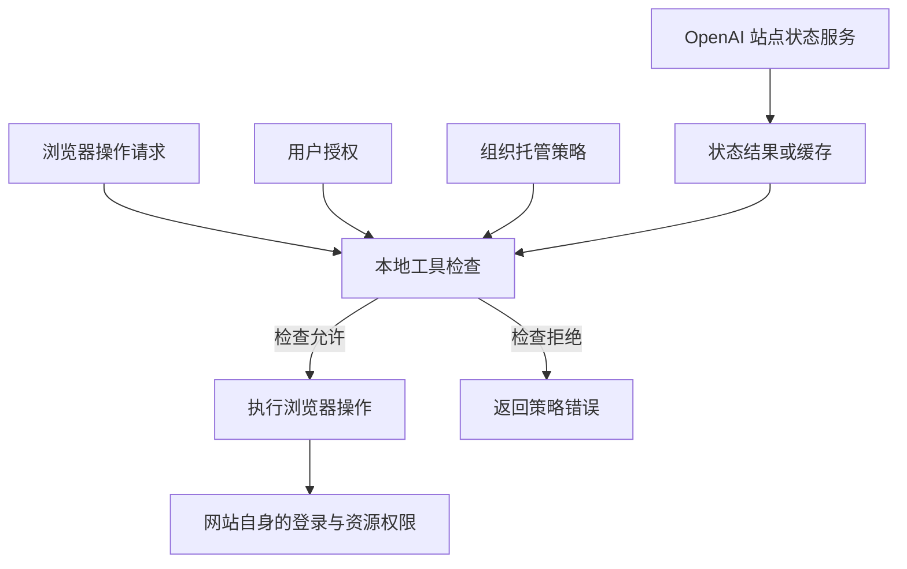

# Codex 浏览器站点安全检查：云端判定与本地权限边界

## 要解决的问题

浏览器已经登录，用户也允许 Codex 读取页面，但工具仍报告站点安全策略拒绝访问。这并不矛盾：网站身份认证、用户授权和工具自身的安全判定分别回答不同的问题。

本文记录截至 **2026-10-15** 的机制核查。内部字段与接口来自当时安装的浏览器工具实现；它们是版本相关的排障线索，不是公开稳定的 API 契约。社区报告用于交叉验证现象，不代表官方已经确认根因或修复方案。

## 不同权限回答不同问题

| 检查层 | 回答的问题 | 放行能证明什么 |
| --- | --- | --- |
| 网站登录态与资源权限 | 当前网站账户能否查看这份内容？ | 网站可能允许该账户访问 |
| 用户对工具的授权 | 用户是否同意 Agent 执行这类操作？ | 用户意图允许该操作 |
| 组织托管策略 | 管理员是否允许使用这一浏览器能力或来源？ | 通过组织设置的限制 |
| OpenAI 站点安全判定 | 工具是否允许在该目标站点执行操作？ | 通过这一站点检查 |
| 操作级审查 | 本次具体动作是否还需要确认或进一步审查？ | 本次动作满足相应要求 |

通过一层检查，不等于通过其他层。官方托管配置文档也明确区分来源权限和动作批准：配置来源允许规则，并不代表该来源上的所有动作均已获准；本地设置不能放宽组织托管的拒绝规则。[官方托管配置说明](https://learn.chatgpt.com/docs/enterprise/managed-configuration#control-browser-and-computer-use)

因此，“可以列出标签页”“可以看到页面标题”“手动浏览正常”均不足以证明浏览器工具可以读取正文。列举浏览器表面信息与取得页面操作能力，可能采用不同的检查路径。

## 云端判定与本地执行如何配合

核查到的实现包含以下机制：

1. 浏览器工具使用 OpenAI 域名下的 `chatgpt.com/backend-api/aura/site_status` 查询路径获取站点状态。
2. 客户端根据返回状态作出放行或拒绝决定，并存在结果缓存逻辑。
3. 站点拒绝对应 `site_status_blocked`，相关诊断将来源标识为 `site_status` 或归类为 `openai_site_policy`。
4. 用户持久化拒绝规则被单独归类为 `user_persisted_setting`，不能与上述来源混为一谈。

这描述的是**云端提供站点判定、本地工具执行限制**的协作方式。它不意味着报错时一定刚刚向云端发起了请求：缓存也可能参与决策。静态代码能说明支持哪些路径，不能代替一次实际请求的网络证据。

下图是检查依赖的概念示意，不代表所有版本的精确调用顺序。

站点状态接口的存在，不足以推断具体分类算法、完整名单、缓存时长或永久封禁范围。缺少对应响应和官方解释时，应保留这些未知项。

## 怎样判断是谁拒绝了访问

关键是错误的**来源与阶段**，而不是仅看“访问失败”。

| 观察到的证据 | 合理结论 | 不能据此推出 |
| --- | --- | --- |
| 页面显示登录二维码 | 这条访问路径缺少网站登录态 | Codex 站点策略允许访问 |
| 工具在获取页面对象时返回站点安全拒绝 | 浏览器工具阻止了操作 | 网站服务器向该请求返回了拒绝 |
| 诊断出现 `site_status_blocked` 与站点判定来源 | 拒绝属于站点状态检查分支 | 目标整个域名被永久封禁 |
| 报错明确表示未尝试用户确认或 Auto-review | 本次被拒绝的动作没有进入这些审批步骤 | 用户点击允许就一定能解除 |
| 本地没有发现拒绝配置 | 已检查的本地配置未解释问题 | 云端或其他配置来源不存在限制 |

在对应站点检查错误已确认的案例里，可以说“这是 Codex/OpenAI 浏览器工具侧的限制”。不应泛化为“这个网站没有任何访问控制”，也不应把其他工具返回的登录问题归因于同一机制。

公开报告提供了相似现象：

- [Codex #35549](https://github.com/openai/codex/issues/35549)：报告者已登录并明确授权，仍在获取页面操作能力时遇到策略拒绝。
- [Codex #53119](https://github.com/openai/codex/issues/53119)：报告包含相同类别的站点拒绝及相关诊断字段；用户允许设置未解决问题。
- [Codex #51945](https://github.com/openai/codex/issues/51945)：另一个站点出现相似拒绝，本地允许配置没有使该操作通过。

这些都是用户提交的一手故障报告。它们支持“本地允许与站点判定是不同检查”的解释，不能当作官方对某个私有文档或目标域名的分类结论。

## 为什么“本地代理返回 OK”不等于解决问题

普通网络代理解决的是请求如何到达服务端。让代理替换安全判定结果，改变的则是客户端收到的授权依据，属于绕过判定本身。

还要区分 HTTP 请求成功与业务判定允许：收到成功状态码，只能说明协议层面的请求成功，不能证明响应内容允许访问，更不能证明其他检查已经通过。在没有实际验证证据时，也不能声称“改一个响应就能解锁整条链路”。

可维护的处理方式是核查分类是否有误、由有权限的一方修正相关策略，或向产品支持提供足够的复现信息。替换判定响应既不能解释原分类原因，也不能证明问题已经被正确修复。本文不提供伪造判定、关闭检查或切换执行通道规避拒绝的步骤。

## 可复用的排查顺序

1. **保留最少必要证据。** 记录时间、应用与浏览器插件版本、操作类型、错误类别和判定来源；分享前移除私有文档路径、查询参数和账户信息。
2. **区分网站认证与工具拒绝。** 登录二维码、网站自身的权限页面和工具发起操作前的策略错误，应分开记录。
3. **核查有效策略来源。** 检查用户设置、组织托管设置与云端管理来源；不要把“某个本地文件没有配置”当成所有策略均为空。
4. **按来源处理。** 用户规则由用户调整；组织规则由管理员核查；站点分类问题向 OpenAI 反馈，并附脱敏后的诊断信息。官方托管配置中的允许规则，不应被描述为覆盖站点分类的通用开关。
5. **区分访问修复与任务继续。** 若用户有权导出材料，可以由用户主动提供脱敏后的文件继续内容分析。这能推进任务，但不等于浏览器访问限制已解除。

在工具明确拒绝某项浏览器操作并禁止规避时，应保留拒绝证据，不再通过替换判定或改用间接执行重复同一受阻动作。核查截至本文记录日期，尚无足够公开证据支持对这类错误给出通用的官方关闭开关或保证有效的修复步骤。

## 证据与适用边界

| 证据类型 | 本文使用方式 | 限制 |
| --- | --- | --- |
| 具体工具错误 | 判断拒绝阶段与是否进入审批 | 仅说明该次动作 |
| 安装版本的静态实现 | 识别接口、错误分类与缓存路径 | 未保存该次失败的原始服务端响应；不公开复制实现源码 |
| 官方配置文档 | 解释本地、托管与动作权限边界 | 不等于公开了站点状态服务的内部规则 |
| 社区一手报告 | 对照同类现象与诊断字段 | 不等于官方确认根因、范围或修复时间 |

复用这份笔记时，应重新确认版本、错误类别与来源。若来源变成组织规则、用户拒绝或网站认证失败，就需要切换到对应排查路径。
