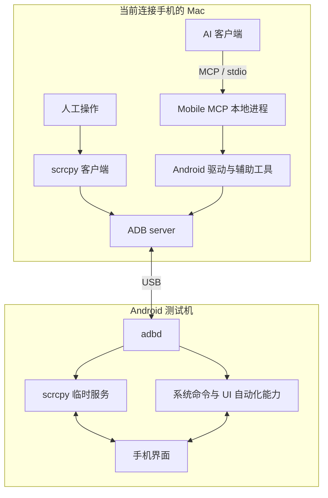

# macOS 控制 Android 测试机：ADB、scrcpy 与 Mobile MCP 方案

希望用 Mac 操作 Android 测试机时，通常同时存在两类需求：自己看着画面，用鼠标键盘完成测试；让 AI 根据测试目标读取界面、执行操作并检查结果。这两种方式可以共用连接底座，但需要不同的操作入口。

本文记录方案设计及初步设备连通验证。当前范围已经确定：**两台 Mac 各自运行同一套工具，手机插在哪台，就由哪台操作。** 手机固定连接一台 Mac、另一台远程访问的托管模式留到后续，目前不实现远程服务、SSH 隧道或设备调度。

文中仓库结构、安装步骤和验收流程均为待落地方案，不能视作已经完成的工具包。

## 从 ADB 开始：它负责连接，但不提供完整操作体验

ADB 是 Android Debug Bridge。Mac 上的命令行客户端通过本机 ADB server，与手机端的 adbd 通信，从而执行安装应用、设备 shell、文件传输、截图和日志采集等操作。普通量产设备上的调试权限不等于 Root 权限。[Android 官方文档](https://developer.android.com/tools/adb)

把手机通过 USB 插上，并不代表 Mac 已经获得控制权限。还需要开启开发者选项和 USB 调试，并在手机上接受这台电脑的调试授权。

本次实际观察到的过程是：最初设备列为 `unauthorized`；用户在手机上允许调试后，设备状态变为 `device`，随后成功读取厂商、型号和系统版本。这说明授权和设备命令链路已打通，但不能据此认定投屏、触摸注入、中文输入和 AI 测试已经可用。

这是搭建时的第一层验收：先证明电脑能够与手机通信，再验证上层交互能力。

## scrcpy 如何把 ADB 连接变成可操作的手机窗口

可以把 scrcpy 理解为建立在 ADB 连接之上的投屏和控制系统。它包含 Mac 上的客户端，以及临时在手机上运行的服务。

在常规调试模式下，启动过程大致是：

1. 客户端通过 ADB 向手机临时目录推送服务程序。
2. 通过 ADB 启动服务并建立通信通道。
3. 手机端采集屏幕并编码视频，Mac 接收、解码并显示。
4. Mac 窗口收到鼠标或键盘操作后，将控制消息发回手机，由手机端执行输入操作。

视频、音频和控制使用各自的 socket。屏幕传输是持续的视频流，因此无需靠反复执行截图命令刷新窗口。“不需要安装普通客户端 App”不代表手机上完全没有运行组件；实际存在临时启动的服务。[scrcpy 架构说明](https://github.com/Genymobile/scrcpy/blob/master/doc/develop.md)

这条链路适合人工测试：用户实时看画面、点击、滑动和输入，并在需要时录屏。常规模式不要求 Root；个别厂商会额外限制输入注入，需要按照设备实际设置验证。[scrcpy 项目与设备要求](https://github.com/Genymobile/scrcpy)

## Mobile MCP 装在哪里，谁在决定下一步操作

MCP 是工具通信协议。Mobile MCP 是实现该协议的程序，本方案将它运行在当前连接手机的 Mac 上。AI 客户端调用它暴露的工具，由它及其 Android 驱动或辅助工具访问设备。

官方提供 Node.js 包，可以通过 `npx` 下载并启动；使用这种方式时包通常缓存在本机 npm 缓存中。为了在两台 Mac 上复用，后续更适合将其作为工具仓库的固定版本依赖，由锁文件管理，再通过仓库脚本启动。手机端不运行 MCP Server，但部分能力可能需要辅助组件，具体安装项应在实践时核对。

默认通信采用 **stdio**：AI 客户端启动本机进程，通过标准输入和标准输出交换请求与结果。本阶段无需启用 HTTP 服务。[Mobile MCP 官方文档](https://github.com/mobile-next/mobile-mcp)

以“打开应用并点击设置”为例，AI 先请求界面元素或截图，依据结果找到目标，再调用点击工具，最后重新读取界面确认是否进入预期页面。AI 负责理解目标、选择动作和判断结果，Mobile MCP 负责提供设备工具和返回证据。

下面是职责示意，具体 Android 驱动实现以实际安装版本为准：



scrcpy 与 Mobile MCP 是两个入口。AI 可以直接调用手机工具，不必先点击 Mac 上的 scrcpy 窗口。两者能访问同一部手机，但测试执行时应避免人工输入与自动操作互相打断。

## 两台 Mac 怎样共享同一套环境

当前选择的是独立本地运行模式：Mac A 和 Mac B 分别安装依赖、读取自己的设备配置，手机移动到哪台电脑，就使用哪台电脑的工具。

Git 仓库共享的是安装方法、配置模板、启动入口和测试用例。每台电脑保留自己的 SDK 路径、设备授权和运行产物。首次连接另一台 Mac 时，应在手机上分别授权，不通过复制 ADB 私钥来省略授权步骤。

建议的工具仓库结构如下。这里的名称仅为示例，尚未创建该仓库或脚本：

```text
android-test-kit/
├── README.md
├── Brewfile                  # scrcpy 等系统依赖清单
├── package.json              # Mobile MCP 的固定版本依赖
├── package-lock.json         # Node 依赖锁文件
├── config/
│   ├── local.example.env     # 本机参数模板
│   └── mcp.example.json      # MCP 接入示意，按客户端适配
├── scripts/
│   ├── setup.sh              # 发现已有 SDK 并安装缺失依赖
│   ├── doctor.sh             # 检查版本、设备连接和授权
│   ├── mirror.sh             # 启动 scrcpy
│   └── mcp.sh                # 启动 Mobile MCP
├── tests/                    # 后续沉淀的回归用例
└── .gitignore
```

这些脚本落地时应满足以下约定：

- 自动发现已有 Android SDK，允许本机配置覆盖路径，避免写死某台电脑的绝对路径。
- scrcpy 与自动化工具使用同一份 ADB。`PATH` 用于发现命令，scrcpy 的 `ADB` 环境变量可以明确指定二进制文件。
- Mobile MCP 固定版本并提交依赖锁文件；Brewfile 只是依赖清单，不应宣称它锁定了所有系统工具版本。检查脚本应报告 ADB 和 scrcpy 的实际版本。
- 只有一台可用设备时可以自动选择；多台设备连接时要求明确目标，避免向错误设备发出操作。
- MCP 客户端配置由模板生成或按需合并，保留用户已有配置，不能整体覆盖。
- 本机配置、凭据、ADB 私钥、运行截图、录屏和原始日志不提交 Git。用例中使用通用数据。

第二台 Mac 的验收标准是：从相同提交初始化，完成手机授权后，能够通过相同入口启动投屏和 AI 工具，并运行相同测试流程。

## 落地顺序与成功标准

### 先验证 USB 连接和人工操作

优先复用已有 ADB，再安装 scrcpy。以下是官方支持的安装和启动思路，本文记录时尚未执行安装：

```bash
brew install scrcpy
adb devices -l
scrcpy
```

前提是所选 ADB 已在 `PATH` 中。已有 Android Studio SDK 时，先配置其 platform-tools 路径；没有 ADB 时再按官方安装说明补充，避免无意引入多份工具。[macOS 安装说明](https://github.com/Genymobile/scrcpy/blob/master/doc/macos.md)

成功标准是能看到正确设备的实时画面，并完成点击、滑动、返回、应用切换。然后单独测试中文输入：可以尝试 `scrcpy --keyboard=uhid`，配置手机侧物理键盘布局并使用手机输入法。它的兼容性仍要在目标设备上确认。[键盘模式说明](https://github.com/Genymobile/scrcpy/blob/master/doc/keyboard.md)

### 再验证 AI 的观察与操作闭环

接入 Mobile MCP 后，按以下顺序验证：发现设备、读取界面元素、获取截图、点击、长按、滑动、返回、中文输入、启动或退出测试应用。

中文输入需要独立验收，不能因为英文输入成功就判定通过。必要的输入法或辅助组件以安装版本说明和实机结果为准。

首条端到端测试应使用受控测试应用或可安全复现的页面，包含中文输入、跨页面操作、结果检查和关键截图。每一步要根据新界面判断下一步，避免只播放固定坐标和等待时间。

### 最后固化环境并验证另一台 Mac

将已成功的依赖版本、初始化方式、启动参数和测试用例纳入工具仓库。在第二台 Mac 上从相同提交重新搭建，用实际成功结果证明复用能力。

后续需要稳定、重复执行回归时，可根据应用情况补充 Python uiautomator2，或使用 Appium 的 UiAutomator2 Driver 组织原生与混合应用测试。这些属于候选扩展，不是当前必装依赖。[uiautomator2](https://github.com/openatx/uiautomator2) · [Appium UiAutomator2 Driver](https://appium.github.io/appium-uiautomator2-driver/latest/overview/)

## “像人一样操作”的边界

点击、滑动和输入覆盖很多日常任务，但不能推导出所有界面和硬件行为都可自动化：

- 使用 `FLAG_SECURE` 的窗口可能无法截图或投屏，视觉自动化也无法据此正常读取内容。[Android 安全窗口说明](https://developer.android.com/security/fraud-prevention/activities)
- 指纹、人脸、真实 NFC 和插拔设备等硬件动作，无法仅靠 ADB 完整替代。
- 自绘界面、游戏和部分 WebView 可能没有完整的控件树，需要截图定位，稳定性必须单独验证。
- 设备厂商、系统版本、输入法和应用实现都会影响结果；一台设备通过不能代表所有 Android 机型通过。

因此当前目标是先覆盖日常应用操作并建立可观察的测试过程，而非承诺任意界面全自动控制。

## 当前证据与后续补充位置

截至 2026-10-26，本次准备工作的实际状态如下。设备标识与个人路径已省略，未附原始日志或截图。

| 项目 | 状态与证据 |
| --- | --- |
| Mac 环境 | 已确认 Apple Silicon、Homebrew 和 Android Studio 存在 |
| ADB | 已找到 SDK 中的 Platform Tools 35.0.2；最初不在当前终端 PATH 中 |
| USB 授权 | 初始为 unauthorized，用户确认后变为 device |
| 系统信息读取 | 已成功读取；测试机为 OPPO、Android 16（API 36） |
| scrcpy | 检查时未在 PATH 和常见安装位置找到，尚未安装或验证 |
| Mobile MCP | 尚未安装或接入 |
| 点击与中文输入 | 尚未实机验证 |
| AI 端到端测试 | 尚未执行 |
| 工具 Git 仓库与第二台 Mac | 仅完成方案设计，尚未创建或验收 |

后续实践直接更新本文对应章节及上表：补充实际依赖版本、手机端设置、中文输入方式、真实故障与修复、端到端测试证据，以及第二台 Mac 的复用结果。普通补充不增加新的内容日志条目。

无线连接和固定托管作为后续独立扩展评估。当前仓库只实现本地模式，不预先加入 HTTP 服务、隧道脚本或远程访问配置。
