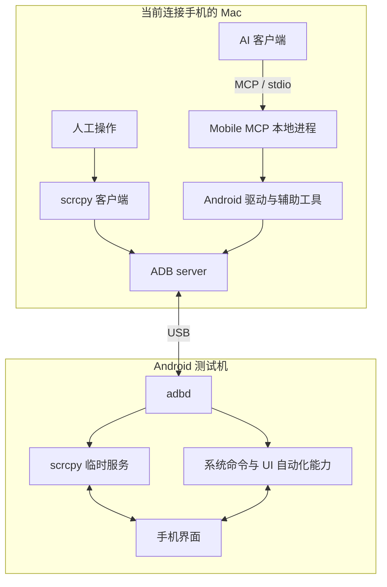

# macOS 控制 Android 测试机：ADB、scrcpy 与 Mobile MCP 实践

希望用 Mac 操作 Android 测试机时，通常同时存在两类需求：自己看着画面，用鼠标键盘完成测试；让 AI 根据测试目标读取界面、执行操作并检查结果。这两种方式可以共用连接底座，但需要不同的操作入口。

本文记录从方案设计到第一台 Mac 实机验证的过程。当前范围已经确定：**两台 Mac 各自运行同一套工具，手机插在哪台，就由哪台操作。** 手机固定连接一台 Mac、另一台远程访问的托管模式已补充候选设计，但尚未实现远程服务、SSH 隧道或设备调度。

截至 2026-10-26，工作区和工具仓库已经创建，用户确认人工投屏可以操作，本地 MCP 客户端也完成了含中文输入的设置页流程，并实际操作京东、淘宝与拼多多完成狗粮比价。Codex 原生工具加载、人工中文输入及第二台 Mac 复现仍待验收。下文将机制、实际操作和这些边界分别说明。

## 从 ADB 开始：它负责连接，但不提供完整操作体验

ADB 是 Android Debug Bridge。Mac 上的命令行客户端通过本机 ADB server，与手机端的 adbd 通信，从而执行安装应用、设备 shell、文件传输、截图和日志采集等操作。普通量产设备上的调试权限不等于 Root 权限。[Android 官方文档](https://developer.android.com/tools/adb)

把手机通过 USB 插上，并不代表 Mac 已经获得控制权限。还需要开启开发者选项和 USB 调试，并在手机上接受这台电脑的调试授权。

本次实际观察到的过程是：最初设备列为 `unauthorized`；用户在手机上允许调试后，设备状态变为 `device`，随后成功读取厂商、型号和系统版本。这说明授权和设备命令链路已打通，但不能据此认定投屏、触摸注入、中文输入和 AI 测试已经可用。

这是搭建时的第一层验收：先证明电脑能够与手机通信，再验证上层交互能力。

## scrcpy 如何把 ADB 连接变成可操作的手机窗口

可以把 scrcpy 理解为建立在 ADB 连接之上的投屏和控制系统。它包含 Mac 上的客户端，以及临时在手机上运行的服务。

在常规调试模式下，启动过程大致是：

1. 客户端通过 ADB 向手机临时目录推送服务程序。
2. 通过 ADB 启动服务并建立通信通道。
3. 手机端采集屏幕并编码视频，Mac 接收、解码并显示。
4. Mac 窗口收到鼠标或键盘操作后，将控制消息发回手机，由手机端执行输入操作。

视频、音频和控制使用各自的 socket。屏幕传输是持续的视频流，因此无需靠反复执行截图命令刷新窗口。“不需要安装普通客户端 App”不代表手机上完全没有运行组件；实际存在临时启动的服务。[scrcpy 架构说明](https://github.com/Genymobile/scrcpy/blob/master/doc/develop.md)

这条链路适合人工测试：用户实时看画面、点击、滑动和输入，并在需要时录屏。常规模式不要求 Root；个别厂商会额外限制输入注入，需要按照设备实际设置验证。[scrcpy 项目与设备要求](https://github.com/Genymobile/scrcpy)

## Mobile MCP 装在哪里，谁在决定下一步操作

MCP 是工具通信协议。Mobile MCP 是实现该协议的程序，本方案将它运行在当前连接手机的 Mac 上。AI 客户端调用它暴露的工具，由它及其 Android 驱动或辅助工具访问设备。

官方提供 Node.js 包，可以通过 `npx` 下载并启动；使用这种方式时包通常缓存在本机 npm 缓存中。本次为了在两台 Mac 上复用，采用工具仓库本地依赖：固定 Mobile MCP 1.0.13，提交 package-lock.json，再由仓库脚本启动。手机端不运行 MCP Server，但实践发现了 mobilecli 下发的辅助代码文件，后文单独列出。

默认通信采用 **stdio**：AI 客户端启动本机进程，通过标准输入和标准输出交换请求与结果。本阶段无需启用 HTTP 服务。[Mobile MCP 官方文档](https://github.com/mobile-next/mobile-mcp)

以“打开应用并点击设置”为例，AI 先请求界面元素或截图，依据结果找到目标，再调用点击工具，最后重新读取界面确认是否进入预期页面。AI 负责理解目标、选择动作和判断结果，Mobile MCP 负责提供设备工具和返回证据。

下面是职责示意，具体 Android 驱动实现以实际安装版本为准：



scrcpy 与 Mobile MCP 是两个入口。AI 可以直接调用手机工具，不必先点击 Mac 上的 scrcpy 窗口。两者能访问同一部手机，但测试执行时应避免人工输入与自动操作互相打断。

## 两台 Mac 怎样共享同一套环境

当前选择的是独立本地运行模式：Mac A 和 Mac B 分别安装依赖、读取自己的设备配置，手机移动到哪台电脑，就使用哪台电脑的工具。

Git 仓库共享的是安装方法、配置模板、启动入口和测试用例。每台电脑保留自己的 SDK 路径、设备授权和运行产物。首次连接另一台 Mac 时，应在手机上分别授权，不通过复制 ADB 私钥来省略授权步骤。

实际采用了“工作区仓库 + 工具仓库”两层结构。前者维护 Astrail 配置、项目目标和验收状态，后者独立维护 Android 工具、依赖与实践文档。两个仓库均已通过 Git 保存。以下目录名称经过泛化，结构对应本次实现：

```text
device-workspace/
├── astrail.yaml              # runtime.mode: global，登记仓库及 local 环境
├── astrail.lock.yaml
├── context/
│   ├── project.md
│   └── validation.md
├── scripts/astrail.sh        # 明确调用全局开源 Astrail
├── .codex/config.toml        # 本机生成，Git 忽略
└── repos/                   # 工作区 Git 忽略；子仓库自行管理版本
    └── device-tools/
        ├── README.md
        ├── package.json
        ├── package-lock.json
        ├── config/local.example.json
        ├── scripts/
        │   ├── setup.sh
        │   ├── android.mjs   # doctor / mirror / mcp
        │   └── configure-codex.mjs
        ├── tests/
        ├── docs/practice/
        └── artifacts/       # 截图、录屏、原始日志，Git 忽略
```

本次使用 npm 全局安装的开源 Astrail 0.15.0，声明 `runtime.mode: global`；工作区包装脚本明确选择该安装，避免同名命令意外调用另一发行版本。Astrail 管理仓库和上下文，实际手机操作由工具仓库承担，工具仓库可脱离 Astrail 使用。

落地时保留了这些约定：

- ADB 按环境变量、本机配置、SDK 位置和 PATH 发现，优先复用已有 SDK。scrcpy 与自动化入口使用同一份 ADB。
- Mobile MCP 使用固定版本及 npm 锁文件；Homebrew 安装系统依赖并记录实际版本。本次未实现 Brewfile，也没有宣称系统依赖全部锁版。
- 多设备连接时必须明确目标；指定设备不存在、未授权或离线时失败，不自动切换到另一台。
- MCP 配置在每台 Mac 上生成本机绝对路径；已有文件保留并输出待合并片段，不整体覆盖。
- 本机配置、凭据、ADB 私钥、截图、录像和原始日志不提交 Git。

第二台 Mac 的验收标准是：从相同提交初始化，完成手机授权后，能够通过相同入口启动投屏和 AI 工具，并运行相同测试流程。

## 实际安装了什么，配置了什么

### Mac：新增工具与原有 SDK 分开记录

以下版本是本次实践样本，不代表所有环境必须选择这些版本，也不是“当前最新版本”承诺。

| 组件 | 本次处理 | 位置与作用 |
| --- | --- | --- |
| 开源 Astrail 0.15.0 | npm 全局安装 | 工作区使用 global runtime，明确调用开源版本 |
| scrcpy 5.0.1 | Homebrew 安装 | 提供人工投屏、控制与录屏 |
| scrcpy 相关依赖 | Homebrew 自动安装或更新 | 包括 FFmpeg 9.0.2_1、SDL3 3.4.18、libusb 1.0.30、OpenSSL 4.1.0 等；不是全部传递依赖清单 |
| Mobile MCP 1.0.13 | 工具仓库本地 npm 安装 | 位于 node_modules，不是全局 npm 服务 |
| mobilecli 1.0.21 | 随 npm 依赖安装 | 本机 Android 自动化执行组件 |
| Android SDK Platform Tools 35.0.2 | 复用原有安装 | 提供统一 ADB，不另装一套 SDK |
| Node.js、npm、Homebrew、Git、gh、Codex | 复用已有工具 | 没有因本次实践重新安装这些基础工具 |

工具仓库提供环境检查、投屏和 MCP 入口。实际基础命令如下，应在工具仓库中运行：

```bash
npm ci
npm run check
npm run doctor
npm run mirror
```

`doctor` 检查工具和设备是否就绪，不替代 UI 验收。启动器优先使用受 Homebrew 管理的 scrcpy，并在其子进程中隔离外来服务端路径；修复细节见下一节。可选 `setup.sh --system` 负责安装 scrcpy、执行 npm ci 和环境检查。[scrcpy macOS 安装说明](https://github.com/Genymobile/scrcpy/blob/master/doc/macos.md)

### Android：没有安装 MCP App，但存在辅助代码

| 项目 | 实际处理与观察 |
| --- | --- |
| 开发者选项、USB 调试和电脑授权 | 手机已开启 USB 调试，用户授权当前 Mac；ADB 状态为 device |
| scrcpy 手机端程序 | 投屏时经 ADB 临时下发并启动；不是普通安装的 App。后续临时目录检查未发现该文件残留 |
| mobilecli.dex | 自动化工具下发到设备临时目录；后续观察到该文件约 76 KB，不是正式安装 APK |
| MCP Server | 安装并运行在 Mac；手机没有安装独立 MCP Server App |
| 额外 APK | 本次没有手动安装额外 APK；针对相关工具包名的筛查没有匹配结果 |

mobilecli 的 agent 状态命令返回 Android 不需要单独的 agent 安装步骤，但这不等于它不下发任何代码：设备临时目录中实际存在 `mobilecli.dex`。区分“APK 安装”“临时文件下发”和“运行中的进程”，才能准确回答手机发生了什么变化。

本次没有采集实践前的完整 APK 清单，因此不把当前包名筛查结果当作完整安装历史。没有执行 Root、刷机或无线 ADB 配对，也没有改动主题、亮度或网络开关；系统可能保留本次设置搜索历史。

### Codex：配置在工作区，不在全局

本次生成的是工作区根目录下的 `.codex/config.toml`，服务名为 `android_mobile`。没有把该服务添加到全局 `~/.codex/config.toml`。下例是重建的通用配置示意，路径均为占位值，不可直接运行：

```toml
[mcp_servers.android_mobile]
command = "/path/to/project/runtime/bin/node"
args = ["/path/to/project/repos/device-tools/scripts/android.mjs", "mcp"]
cwd = "/path/to/project/repos/device-tools"
startup_timeout_sec = 30
tool_timeout_sec = 120

[mcp_servers.android_mobile.env]
MOBILEMCP_DISABLE_TELEMETRY = "1"
```

客户端直接执行 Node 和脚本，通过 stdio 通信；不使用可能向 stdout 输出启动日志的 `npm run mcp` 作为正式协议入口。启动器保持 stdout 用于 MCP 消息，统一 Node 与 ADB 路径，并检查设备授权和选择。设备选择检查不构成服务端访问隔离，每次工具调用仍需传入目标设备 ID。

Codex 文档支持受信任项目的 `.codex/config.toml` 配置；这描述的是配置方式，不代表本次客户端已加载。[Codex MCP 配置说明](https://developers.openai.com/codex/mcp)

本次实际情况是：文件已生成，本地协议客户端成功调用 Mobile MCP；但当前聊天未加载原生工具，codex-cli 0.163.0 的 `mcp get` 也未识别这个项目服务，具体原因尚未确定。因此“配置生成”“协议调用成功”“Codex 原生集成成功”是三个不同验收项，最后一项仍待完成。

## 实际遇到的冲突：新版客户端加载了旧版服务端

最初只看 PATH，发现一款 NAS 桌面客户端附带了 scrcpy。于是安装官方版本，并显式调用新版可执行文件。这个动作仍然失败：错误指出 Mac 客户端是 5.0.1，手机端服务程序却是 2.0。

这说明“选中了正确的客户端路径”还不够。进一步检查发现，继承的 `SCRCPY_SERVER_PATH` 环境变量仍指向另一款应用附带的旧服务端。scrcpy 将它推送到手机后，就出现了版本不匹配。[scrcpy 服务端路径与运行机制](https://github.com/Genymobile/scrcpy/blob/master/doc/develop.md)

为什么 NAS 软件会包含这套工具？本机安装包的只读检查显示，其云手机模块会建立连接、调用 ADB，再启动 scrcpy。对应初始化逻辑还会向 shell 启动文件追加服务端路径和工具 PATH；本机配置中也存在匹配内容。这里记录调查结论，不公开应用内部源码、真实路径或原始输出，也不据此推断用户曾使用过该功能。

通用教训是：**应用内部依赖一旦被写入用户级 shell 环境，就可能影响其他同名工具。** 排查应同时确认客户端路径、服务端路径及继承环境，而不是只重复升级客户端。

本次修复只作用于测试启动器：

1. 显式配置优先，其次选择 Homebrew 管理的 scrcpy，再考虑 PATH 中的其他副本。
2. 启动投屏子进程前去掉继承的 `SCRCPY_SERVER_PATH`，让客户端使用自身配套服务端。
3. 通过统一 ADB 环境重新验证连接、视频解码和操作。

没有修改用户的 shell 配置或删除另一款应用的工具。隔离后，scrcpy 成功使用 Metal / VideoToolbox 显示 1080 × 2354 画面；用户随后亲自尝试并确认可以操作。

另一个安装问题是 Homebrew 初次启动时出现 PATH 相关的 UTF-8 编码异常。使用最小 PATH 和 UTF-8 locale 后安装成功，初始化脚本据此隔离了不相关的应用路径。该措施针对本次环境故障，不应被当作所有 Homebrew 安装都必须使用的设置。

## 第一条 AI 流程：中文搜索、进入页面、滑动、返回

本次使用系统设置页作为基线，没有安装业务测试 App。测试机是 Android 16（API 36），屏幕为 1080 × 2354。

| 步骤 | 操作 | 成功证据 |
| --- | --- | --- |
| 1 | ADB 打开系统设置；MCP 完成握手和设备发现 | 返回目标设备在线状态 |
| 2 | 读取元素树，按元素 ref 点击搜索框 | 输入框获得焦点 |
| 3 | 输入“显示” | 元素 text/value 与截图都出现该中文文本 |
| 4 | 等结果出现后重新读取元素树，点击“显示与亮度” | 新页面标题及相关设置控件出现 |
| 5 | 向上滑动 650 像素 | 相同控件位置变化，显示大小、屏幕分辨率等进入可见区域 |
| 6 | BACK 返回搜索结果，再取消搜索 | 元素树和截图确认返回，最终恢复设置首页 |

这里不能只相信工具返回“点击成功”或“文本已输入”。必须用动作后的界面结果复核。实践中，刚输入后的元素读取仍可能包含旧的建议区域；稍后的截图已经显示搜索结果，因此在选择目标前重新读取了元素树。类似地，刚打开设置便截图可能捕捉到过渡动画，不能当作稳定页面证据。

截图有时会缩放。本次 MCP 截图为 642 × 1400，而实际屏幕为 1080 × 2354；如果改用截图坐标点击，必须按工具返回的比例映射。优先使用最新元素树中的 ref，页面变化后重新获取，不能跨布局变化复用旧引用。

中文输入此次经 Mobile MCP 实际成功；这不能推断 scrcpy 人工中文输入也成功。UHID 模式已经启动并参与录制，但人工键盘输入仍未验收。后续应按照手机物理键盘和输入法配置独立测试。[scrcpy 键盘模式说明](https://github.com/Genymobile/scrcpy/blob/master/doc/keyboard.md)

## 从设置页走进业务 App：一次狗粮比价实践

设置页流程通过后，进一步尝试了真实任务：用户在手机上打开了一款狗粮，希望搜索京东、淘宝等平台，找到价格优惠且商家相对可靠的同款。商品限定为馋不腻全价老年期犬粮，6 岁以上、紫色包装、每袋 2.5kg；用户接受多袋装，优先每公斤价格。

实际覆盖京东、淘宝／天猫和拼多多，通过本地 stdio 协议客户端直接调用手机工具。该结果扩展了业务 App 操作证据，仍不代表 Codex 原生 MCP 工具已经加载，也没有新增可重复运行的电商回归套件。

### 输入成功，需要由输入框证明

淘宝出现了一个基线测试没有暴露的问题：`mobile_type_keys` 返回成功，搜索框却仍然为空。后来通过依赖中的 mobilecli 设置中文剪贴板，在原生输入框长按粘贴，再读取元素的 text/value 确认内容，才继续搜索。这是本次可用的回退路径，不是已经验证的 MCP 原生剪贴板工具。

京东则出现了另一种失败：修改搜索词时，新内容追加在旧查询之后。处理方式是使用页面可见的清空按钮，重新输入并检查完整字符串。只判断“包含目标关键词”会漏掉这类错误。

这两次观察说明，系统设置中中文输入成功不能外推到所有 App；工具成功响应也不能代替业务结果。更可靠的循环是：**读当前界面 → 执行动作 → 重读界面 → 判断目标是否达成**。

剪贴板还有恢复问题。本次保留了备份并尝试条件恢复，但结束时因为内容变化或备份格式不同而跳过，不能记为恢复成功。后续需要验证备份格式，并且仅在当前内容仍属于本轮操作时恢复，避免覆盖用户的新内容。原有剪贴板内容不进入公开记录。

### 页面状态与登录态也需要重新确认

淘宝链接曾打开到浏览器并要求登录，因此返回已经登录的原生 App 继续。手机 App 的会话不能当作浏览器已登录的证据。点击后立即读取也可能仍看到旧页，优惠券和视频浮层会改变实际点击目标；需要等目标页面出现后重新取元素，而非一直重试同一坐标或旧 ref。

手机中途自动锁定，由用户在手机上解锁后继续，没有绕过锁屏。截图仍可能缩放：本次 642 × 1400 截图对应 1080 × 2354 实际屏幕，坐标点击分别按宽、高比例转换。使用元素引用也必须先确认它来自当前页面。

### 用户的两次修正，改变了结果组织方式

首轮侧重旗舰店和自营，用户要求继续搜索普通商家，并将单包、多包分别排序。因此后续增加了第三方候选，同时把每个报价的核验程度放进结果：搜索页、规格面板、已选 SKU、支付前预览。它们提供的证据强度不同，不能都写成“最终到手价”。

下表仅用于说明本次记录方法，取证于 2026-10-26 晚间，金额受当时账号、优惠和页面状态影响，不是持续有效的购买推荐。两组各自按元/kg 排序，赠品不计狗粮重量。

| 分组 | 实际商家／规格 | 页面金额 | 元/kg | 核验程度与条件 |
| --- | --- | ---: | ---: | --- |
| 单包 | 天猫馋不腻旗舰店，2.5kg | 111.15 元 | 44.46 | 已选规格，限时券后价，未单独结算 |
| 单包 | 馋不腻京东自营旗舰店，2.5kg | 118.00 元 | 47.20 | 商品详情与规格，普通展示价 |
| 单包 | 淘宝汪梵思品牌店，2.5kg | 158.60 元 | 63.44 | 已选规格，券后包邮，未结算、未核授权 |
| 多包 | 天猫馋不腻旗舰店，12 袋／30kg | 1122.00 元 | 37.40 | 支付前预览，包邮，当前账号优惠 |
| 多包 | 京东馋不腻官方旗舰店，12 袋／30kg | 1214.00 元 | 40.47 | 已选 SKU，入会价，未入会、未结算 |
| 多包 | 拼多多馋不腻官方旗舰店，12 袋／30kg | 1215.50 元 | 40.52 | 已选规格，提交订单前面板显示多多支付 |
| 多包 | 京东梦骁萌宠店，12 袋／30kg | 1792.00 元 | 59.73 | 仅搜索页，运费与授权未核验 |

其中，天猫 30kg 预览能对账为 `1430 − 店铺优惠 216 − 限时券 12 − 消费券 80 = 1122`，再除以 30kg 得到 37.40 元/kg。页面另外出现的 PLUS 搜索价、买两件提示价没有完成独立结算，应作为条件价单列，而不能覆盖已核实的普通展示价。

补搜后，没有发现更低且已确认同款的第三方报价。但这只能说明本次样本结果，不能声称全网最低。30kg 的生产批次和剩余保质期也未确认；其他单包的日期不能外推到这个 SKU。

### 商家判断不能只看标题和低价

第三方商品标题可能写着“旗舰店官方正品”，实际店名却是另一家品牌店。应该打开店铺页核对身份，再分别记录品牌授权、商品销量、评价和履约信息；不能把店铺总销量当作单个商品销量，也不能把“京东官方旗舰店”直接等同于“京东自营”。本次没有核实第三方品牌授权，不根据店名或样本少就认定假货。

较低价格还可能来自不同配方或不同规格。本次排除了低脂款、益生菌款，以及未确认老年期同款的低价成犬通用粮。比较前先定义同款条件，比先把所有数字从低到高排序更有用。

### 不为补全价格而越过操作权限

本次没有提交订单、付款或联系商家。部分页面展示了支付或提交订单前的预览；补搜时，自动审批拒绝了一个拼多多候选的“免拼购买”点击，理由是可能进入购买流程、超出搜索比价授权。没有换工具绕过，而是继续读取当前详情，把无法确认的规格保留为未确认并排除出同款结论。

这是本次具体动作的审批结果，不能推导为所有同名按钮的统一行为。业务探索应按动作可能产生的效果判断权限；无法继续核实的价格，诚实记录证据边界即可。

这次的 MCP 请求／响应、截图、错误日志和本地报告归档在忽略目录，并生成文件哈希清单。原图可能带收货信息、通知、分享联系人，响应可能带设备标识，本文只保存脱敏流程和历史金额。复现时应检验输入、选中规格与商家信息能否正确读取，而不是断言优惠后的价格永远相同。

## 怎样保存证据，才能在第二台 Mac 上继续实践

本次把带时间戳的 MCP 请求/响应、关键截图、失败与成功日志、约 174 秒录屏、测试输出和 SHA-256 清单保存在本机忽略目录。录屏经过完整解码检查，并已结束。工具入口的 6 项设备选择与环境隔离测试通过，仓库 CI 也通过；这些代码检查不替代上述 UI 结果。

截图可能暴露头像、通知、搜索历史和输入法的剪贴板提示；日志可能带设备序列号或本机路径。因此公开文章只记录脱敏后的流程与结论，没有上传这些原始资料。文件校验清单用于确认保存的文件一致，不证明测试本身正确。

第二台 Mac 应拉取工作区和工具仓库，并记录两者实际提交；分别安装系统工具和 npm 锁定依赖，授权手机，生成本机 MCP 配置，再执行同一条设置页流程。只共享 Git 中的配置文件，不能共享另一台 Mac 已完成的授权状态。

目前这一步还未执行，因此“两个仓库可共享”和“两台 Mac 均验收成功”不能混为一谈。待需要稳定业务回归时，再评估 uiautomator2 或 Appium UiAutomator2 Driver；它们不是本次已安装的依赖。[uiautomator2](https://github.com/openatx/uiautomator2) · [Appium UiAutomator2 Driver](https://appium.github.io/appium-uiautomator2-driver/latest/overview/)

## 手机固定放在家里：连接方案和解锁方案要分别设计

截至 2026-10-27，以下内容是后续设计，尚未实施远程托管、保存 PIN 或验证自动解锁。前面的 USB、投屏和应用操作结果，不能替代锁屏场景验收。

### 远程访问的是托管 Mac，手机仍通过 USB 连接

两台 Mac 独立运行的方案适合带着手机移动。如果手机固定放在家里，可以让一台 Mac 常驻连接手机，远程用户通过经过认证的安全连接访问这台 Mac，再由本机 Agent、Mobile MCP 和 ADB 操作手机。人工需要看画面时，可另用远程桌面访问托管 Mac 的投屏窗口。

这是通用设计，不是已经部署的网络拓扑。无需为了远程调用就把 Mobile MCP 改成公网 HTTP 服务，也不应直接把 ADB 端口暴露到公网。具体远程入口、主机唤醒和故障恢复方式仍待选型；Mac 必须保持可访问，手机需要稳定供电与 USB 连接。Git 继续共享脚本和模板，各机器的授权与凭据仍独立管理。

### 能唤醒屏幕，不代表能通过密码锁

“ADB 能否解锁”要先区分手机处于什么状态：

| 手机状态 | 可以考虑的操作 | 尚需确认的条件 |
| --- | --- | --- |
| 显示关闭，但仍已解锁 | 唤醒或继续远程操作 | 当前确实没有进入密码锁 |
| 只有滑动锁屏 | 模拟滑动进入桌面 | 设备是否允许该输入操作 |
| PIN 或密码锁屏 | 输入已知的正确凭据 | 锁屏输入注入、确认动作与状态检测是否兼容 |
| 要求指纹或人脸 | 使用系统提供的密码回退入口 | ADB 不能代替真实生物识别 |
| 重启后的首次解锁 | 单独验证连接和凭据输入 | 不能由普通锁屏的成功外推 |

PIN 在这里指手机的数字锁屏密码，例如四位或六位数字，不是 SIM 卡 PIN。自动输入正确 PIN 仍然是在完成正常身份验证，不是绕过密码。Android 的锁屏解除接口也区分无安全锁或受信任状态，与需要显示凭据验证界面的安全锁状态。[Android KeyguardManager](https://developer.android.com/reference/android/app/KeyguardManager)

### 方案一：已经解锁，保持唤醒，只关闭实体屏幕

例如先解锁手机并进入设置，再关闭实体屏幕显示：手机放在桌上是黑屏，Mac 投屏仍能显示设置，工具继续点击和滑动。scrcpy 提供 `--turn-screen-off` 和 `--stay-awake` 的组合；后者要求设备接电，并在正常退出时恢复原有保持唤醒设置。[scrcpy 设备控制文档](https://github.com/Genymobile/scrcpy/blob/master/doc/device.md)

这两个参数是待验证的候选配置，尚未接入本项目启动器。它们不能解除已经存在的密码锁，也不能保证重启、主动锁定或厂商策略下永远保持解锁。

因此，“保持唤醒、关闭实体屏幕”的目标就是**维持已解锁的可操作状态，只让屏幕不发光**。拿到手机的人可能通过实体电源键重新亮屏，并在仍然解锁时直接操作。黑屏没有增加锁屏保护，适合放在限制他人接触的可信位置，尤其是专用测试机；不能因为外观看不到画面，就认为手机已受到密码保护。

### 方案二：平时锁屏，任务开始时由 Mac 输入 PIN

这个方案多了一层凭据管理：手机保留锁屏密码，Mac 上的本地工具按需获取正确 PIN、输入并验证结果。拟采用以下流程：

1. 检查目标设备、连接与锁屏状态；已解锁时无需再次输入。
2. 本地专用工具读取凭据，唤醒手机并打开密码输入界面。
3. 输入正确 PIN，检查是否已离开锁屏并可操作目标应用。
4. 执行测试；任务结束或异常退出时尝试重新锁屏，并确认结果。
5. 输入失败立即停止，不循环尝试密码；无法确认重新锁屏时报告状态。

建议将 PIN 存入 macOS 钥匙串，由本地工具读取，Agent 只调用解锁动作，不直接接收密码。钥匙串提供秘密数据存储机制，但工具的访问权限、钥匙串锁定状态和是否弹出授权提示仍需单独配置与测试。[Apple Keychain Services](https://developer.apple.com/documentation/security/keychain-services)

实现时还需避免 PIN 进入 Git、配置文件、模型上下文、shell 历史、进程命令行及调试日志。保存进钥匙串并不自动消除后续传递过程的泄漏，也不能保证后台任务始终能读取。Mac 重启或会话变化后的可用性应列入验收。

安全边界也随之变化：手机平时仍有锁屏保护，但能够取出 PIN 的 Mac 和解锁工具成为控制入口。“Agent 看不到 PIN”不等于“Agent 无法解锁手机”；谁能调用该工具、能操作哪些设备，都需要限制。当前没有保存 PIN，也没有实现上述工具，锁屏输入兼容性尚未验证。

### 方案三：专用测试机不设置安全锁

如果设备仅放测试数据、没有个人账户，可以考虑不设置 PIN 或密码，减少无人值守时的凭据步骤。代价是设备失去这层锁屏保护，也无法覆盖真实的密码锁测试场景。是否允许还取决于设备管理策略；当前没有修改手机的锁屏设置。

| 方案 | 手机空闲时的状态 | 适用条件与代价 |
| --- | --- | --- |
| 解锁后黑屏保持唤醒 | 目标是持续已解锁 | 配置较少，但依赖物理环境可信，黑屏不是保护 |
| 保留 PIN，按需输入 | 平时锁屏，任务期间解锁 | 更符合按需远程测试，需要凭据管理与解锁、回锁验证 |
| 专用机不设安全锁 | 不要求锁屏凭据 | 维护较少，但没有密码保护，不适合保留个人敏感数据 |

对于长期托管，当前倾向于第二种：**平时锁屏 → 任务时解锁 → 完成后重新锁屏**。这只是建议，尚未据此改变设备配置。

### 后续实践需要验证哪些状态

先验证短时间黑屏时人工投屏和 AI 工具能否继续操作，再分别验证主动锁屏、闲置锁屏、USB 重连、手机重启和 Mac 重启。不能只验证“成功输入过一次 PIN”，就宣称可以长期无人值守。

手机重启尤其需要独立验证：Android 的凭据加密存储在启动后首次解锁前不可用，普通应用可能尚不能正常工作；首次解锁之后再次锁屏，该存储仍可用，直到下一次重启。这与屏幕是否发光是不同维度。[Android Direct Boot](https://developer.android.com/privacy-and-security/direct-boot)

每次实践应记录初始锁屏状态、供电和连接、调用结果、实际进入的界面、任务结束后的锁屏状态及异常恢复结果。解锁阶段不保存含凭据的录屏或输入日志，公开文章只补充脱敏后的观察。现有中文输入和业务 App 操作证据，不能证明密码输入、断连恢复或回锁已经通过。


## “像人一样操作”的边界

点击、滑动和输入覆盖很多日常任务，但不能推导出所有界面和硬件行为都可自动化：

- 使用 `FLAG_SECURE` 的窗口可能无法截图或投屏，视觉自动化也无法据此正常读取内容。[Android 安全窗口说明](https://developer.android.com/security/fraud-prevention/activities)
- 指纹、人脸、真实 NFC 和插拔设备等硬件动作，无法仅靠 ADB 完整替代。
- 自绘界面、游戏和部分 WebView 可能没有完整的控件树，需要截图定位，稳定性必须单独验证。
- 设备厂商、系统版本、输入法和应用实现都会影响结果；一台设备通过不能代表所有 Android 机型通过。

因此当前目标是先覆盖日常应用操作并建立可观察的测试过程，而非承诺任意界面全自动控制。

## 当前验收状态与后续补充

截至 2026-10-27，结果如下。这里区分工具安装、真实调用、用户确认与尚未执行的验证。

| 项目 | 状态与证据 |
| --- | --- |
| USB 与 ADB | 授权完成；复用 Platform Tools 35.0.2，设备命令正常 |
| 工作区与工具仓库 | 已创建并推送；开源 Astrail 0.15.0 / global runtime，工作区检查通过 |
| 人工投屏 | 官方 scrcpy 5.0.1 已安装；画面、录屏通过，用户确认基本操作可用 |
| 人工中文输入、右键返回和应用切换 | 没有逐项完成验收；不能由“可以操作”推断全部通过 |
| Mobile MCP | 1.0.13 已安装；本地 stdio 客户端完成设备发现、截图、元素读取和操作 |
| AI 中文输入和设置页流程 | 实机成功；淘宝空输入、京东追加输入说明业务 App 仍需分别验收 |
| 电商业务探索 | 实际操作京东、淘宝与拼多多，补搜普通商家并分单包／多包比价；尚无固定断言的回归套件 |
| Codex 原生 MCP | 项目配置已生成，全局配置未添加服务；实际加载与原生调用仍待验证 |
| 代码检查 | 6 项设备选择和环境隔离测试通过，工具仓库 CI 成功 |
| 第二台 Mac | 复用方案和脚本已具备，尚未实机复现 |
| 远程托管与解锁 | 已记录三种候选方案；黑屏保持唤醒、PIN 保存与输入、任务后回锁及重启恢复均未实测 |

后续直接更新本文对应章节与上表，补充原生客户端加载、人工中文输入、可重复业务回归及第二台 Mac 的结果。普通修订不增加新的内容日志条目。固定托管的连接方式与解锁策略已形成候选方案，后续需分别验证；无线连接、HTTP MCP 服务、隧道和远程设备调度仍未实现。
