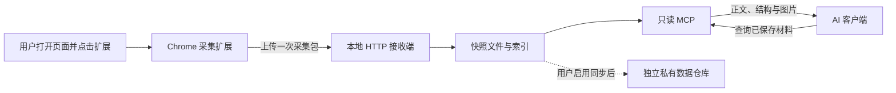

# 面向 AI 的网页采集器：产品定位、只读架构与演进路线

## 产品定位

这是一个由用户主动触发的网页材料采集工具：用户在 Chrome 中打开有权查看和导出的页面，点击扩展，将正文、结构化内容和截图保存到本地，再通过只读 MCP 交给 Codex 等客户端检索、阅读和引用。

产品交付的核心是一份**可阅读、可复核、注明采集范围的网页快照**。浏览器负责呈现页面，用户决定采集对象，扩展负责提取，本地服务负责保存，AI 根据任务按需读取。一次采集可以供多个问题复用，关闭网页后仍能阅读已经保存的版本。

本文记录 **2026-10-15 确定的产品方向与 MVP 设计**。公开文档支持浏览器采集和 MCP 接入的基础能力；端到端实现、企微文档提取质量及具体站点兼容性仍需验证。以下接口、数据结构和验收标准是设计建议，不代表已经完成的功能。

## 为什么需要这个产品

### 网页可见与 AI 可用之间存在断层

用户已经在浏览器登录，并不意味着一个独立抓取服务能读到同一份内容。直接请求 URL 可能只拿到登录页或应用外壳；复制粘贴容易丢失表格、图片和层级；单张截图又很难支持全文检索、精确引用和长文阅读。

浏览器工具还可能受到独立的来源与操作限制。相关机制见 [Codex 浏览器站点安全检查：云端判定与本地权限边界](/knowledge/ai-engineering/codex-browser-site-safety-policy)。用户主动导出材料可以支持后续分析，但不能据此承诺解除原有访问限制。产品不提供伪造判定、关闭检查或由 AI 间接重试被禁止浏览器动作的能力。

这类需求的共同点是：用户知道要读哪份材料，已经能人工打开它，希望减少整理上下文的成本，并且不需要 AI 修改网页。

### 优先服务的任务

| 任务 | 当前阻力 | 采集器提供的帮助 |
| --- | --- | --- |
| 阅读企微文档等协作文档 | 登录态、复杂编辑器、长文内容不易导出 | 保存可提取正文与视觉证据，并标明缺口 |
| 根据需求文档分析代码或写方案 | 多次复制材料，容易丢失来源 | 将指定快照作为可以反复查询的上下文 |
| 阅读包含表格和图表的页面 | 纯文本或截图各自损失信息 | 同时提供文字、结构与图片 |
| 对比两个时间点的材料 | 在线内容变化，引用难以复核 | 为每次采集保留时间、版本和来源 |

已有官方 API 或文档连接器能准确返回内容时，应优先使用它们。网页采集器主要补足用户可见内容缺少适当读取接口的场景；它的价值在于采集质量、来源追踪和使用便利性。

## 设计原则

1. **用户决定采集，AI 决定怎样阅读。** 点击扩展产生快照；MCP 请求只查询已保存内容。
2. **在授权范围内保留证据，按任务提供内容。** 保存多种表示，避免一次把所有 HTML 和图片送入上下文。
3. **如实表达完整性。** 当前可见区域、当前已加载正文和整份文档是不同范围，不能合并成一个“成功”。
4. **清楚区分原文与派生内容。** OCR、摘要和模型解释带有处理方法与版本，能追溯到原图或原文。
5. **先验证高频场景。** 首版打通一键采集与只读阅读，再根据真实样本增加站点适配。

“尽量全”指尽量保留用户指定材料的有效内容，不包括无差别收集 Cookie、页面运行状态、隐藏表单或整个浏览历史。

## 总体架构与只读边界



本地 HTTP 接收端与 MCP 可以由同一个进程提供，但必须保留两类接口的权限区别：扩展可以写入新的采集包，AI 只获得读取权限。系统不建立 MCP 到扩展的浏览器命令通道。

### Chrome 扩展：固定采集逻辑

采用 Manifest V3，通过用户点击触发 `activeTab`，结合 `scripting` 执行预先打包的采集代码。该组合能够为当前页面提供临时访问权限，但它本身不是“只读权限”：实现仍需约束脚本行为。[Chrome activeTab 文档](https://developer.chrome.com/docs/extensions/develop/concepts/activeTab)

首版不向 AI 暴露脚本输入、点击、输入文本、跳转、滚动或重新采集接口。内容提取在 DOM 副本上完成；页面的 Cookie 和浏览器登录凭证不进入采集包。用户再次点击扩展时生成一个新快照。

### 本地服务：接收、验证与持久化

服务以独立进程运行，负责检查数据格式、限制体积、保存文件和建立索引。Chrome 的扩展 Service Worker 有休眠与终止生命周期，不适合作为常驻 HTTP 服务的替代品。[扩展 Service Worker 生命周期](https://developer.chrome.com/docs/extensions/develop/concepts/service-workers/lifecycle)

可使用一个 HTTP 端口提供两个逻辑入口：

```text
POST /captures  扩展提交新的快照，需要写入权限
/mcp            MCP 协议入口，只提供快照查询工具
```

只读指业务能力不会修改网页或采集数据，并不等于只接受 HTTP GET；MCP 协议中的查询调用也可能通过 POST 传输。

服务应绑定回环接口 `127.0.0.1`，校验 Host、Origin 和身份凭证。扩展与 MCP 使用不同权限的凭证，CORS 规则不能替代鉴权。Streamable HTTP 的规范要求验证 Origin，并建议本地服务仅绑定回环地址、为连接提供认证。[MCP 传输规范](https://modelcontextprotocol.io/specification/2025-11-25/basic/transports)

### MCP：读取快照，不驱动网页

建议首版提供四类工具：

| 工具 | 主要参数 | 返回内容 |
| --- | --- | --- |
| `list_captures` | 分页游标、数量上限 | 快照 ID、标题、时间、采集范围 |
| `read_capture` | 快照 ID、章节或分页游标 | 元数据、目录、正文或结构化块 |
| `search_capture` | 快照 ID、关键词 | 匹配片段、块 ID 和上下文 |
| `read_capture_image` | 快照 ID、图片 ID | 已保存图片及其来源说明 |

服务端按 ID 查找已登记的资源，不接受任意 URL、文件路径或可执行代码。工具可声明 `readOnlyHint`，但只读边界必须由实际接口与权限实现，不能依赖一条提示。MCP 支持文字、图片和结构化结果；图片应作为可读取的图片内容提供，不能只返回一个客户端未必能访问的地址。[MCP 工具规范](https://modelcontextprotocol.io/specification/2025-11-25/server/tools)

Codex 支持本地 STDIO 和 Streamable HTTP MCP。[官方 MCP 接入文档](https://learn.chatgpt.com/docs/extend/mcp) 在远程执行环境中，回环地址指向执行工具的机器，连接用户电脑上的服务需要单独设计和验证，不能直接沿用同机假设。

## 采集什么，以及怎样适合 AI 阅读

### 一份快照的多种表示

| 表示 | 首版用途 | 保真边界 |
| --- | --- | --- |
| Markdown 正文 | 默认阅读标题、段落、列表和代码 | 转换可能损失复杂排版 |
| 结构化 JSON | 保存标题层级、表格单元格、链接、图片说明与块关系 | 只能记录实际提取到的结构 |
| 可见区域截图 | 保存布局、图表、Canvas 的视觉证据 | 不覆盖视口外内容，也不等于原始表格数据 |
| 采集元数据 | 记录时间、来源、方法、版本、警告与范围 | 不用猜测填补未知项 |
| 清理后的 HTML | 后续复核和重新提取，可作为增强功能 | 不是可直接重放的完整应用备份 |

正文和结构应尽量从同一份采集结果生成，减少两个提取流程之间的漂移。通用文章可以采用 [Mozilla Readability](https://github.com/mozilla/readability)，处理时传入克隆后的文档；复杂协作文档应验证后再决定是否使用通用正文算法。网页归档可参考 [SingleFile](https://github.com/gildas-lormeau/SingleFile)，直接复用代码前需核对相应许可证。

### 完整性必须成为数据的一部分

建议分别描述文字与截图的范围，而非只放一个全局布尔值：

```json
{
  "schema_version": 1,
  "capture_id": "capture-example-001",
  "source": {
    "title": "示例需求文档",
    "url": "https://example.com/document/example"
  },
  "coverage": {
    "text": "loaded_dom",
    "screenshots": "viewport",
    "document_completeness": "unknown"
  },
  "warnings": [
    "未验证未加载章节",
    "Canvas 内容仅保留视觉证据"
  ],
  "artifacts": ["content.md", "blocks.json", "viewport.png"]
}
```

实际记录还应包含采集时间、扩展和提取器版本、图片尺寸、滚动位置、资源校验值及是否发生截断。块 ID 首先保证在同一快照内稳定；跨版本的段落对应关系是后续独立能力，不能假定编号相同就代表同一段内容。

Chrome 的 `captureVisibleTab()` 捕获指定窗口中当前活动标签页的可见区域。[截图 API](https://developer.chrome.com/docs/extensions/reference/api/tabs#method-captureVisibleTab) 因而采集流程需要核对正文与截图是否来自同一标签页和页面版本；采集期间发生导航或切换页面时，应中止或明确报告不一致。

### 读取顺序

AI 先读取标题、目录、时间和完整性说明，再搜索相关段落，最后按需取得结构化表格或截图。较长正文使用分页与输出上限，返回下一页游标；图片使用图片 ID 取回。

摘要可以作为导航辅助，但原文、结构和截图仍应保留。任何派生摘要都不能悄悄覆盖原始采集结果。

## 最小可用版本怎么做

### 首版闭环

1. 用户在 Chrome 中打开有权访问和导出的目标页面。
2. 点击扩展，采集当前已加载正文、基本结构以及一张可见区域截图。
3. 本地服务验证采集包并持久化，返回快照 ID 和实际保存结果。
4. 扩展显示标题、正文规模、截图数量和缺失提示；失败时给出可操作的原因。
5. Codex 通过 MCP 列出快照、读取正文、搜索片段和查看截图。
6. 用户关闭原网页、重启本地服务后，仍能读取已保存的快照。

首版聚焦人工触发的单页采集，不承诺自动采集整站、完整导出所有协作文档、实时跟踪页面变化或复现一个可交互网页。上传失败不应显示为保存成功，重试应有去重依据，避免同一次操作产生重复记录。

### 产品仓库与数据仓库

产品代码与采集数据使用独立仓库。产品仓库存扩展、本地服务、协议定义、公开测试夹具和使用说明；数据仓库存被允许保存的正文、结构、截图与清单。真实样本文档不能作为产品仓库的测试夹具提交。

建议先在本地持久化，再由用户启用私有数据仓库同步。同步状态与采集状态分别报告：远端同步失败不应丢失本地快照。凭证保存在受限的本机配置中，不进入任一仓库。

Git 适合小规模文字与清单的版本管理，但大量截图会持续扩大历史体积。删除当前版本中的文件也不会自动删除历史副本。后续应按数据保留和删除要求，评估 Git LFS、对象存储或仅同步索引的方式。私有仓库访问范围也需要独立检查，不能等同于来源文档的访问范围。

## 如何验证企微文档的效果

企微文档是优先验证场景，不是已经证明完整支持的范围。应以有权用于测试的具体样本，对照浏览器中的真实内容逐项验收；只打开首页、拿到标题或成功生成截图，都不足以证明文档读取成功。

| 样本或条件 | 验证重点 | 失败时应如何表达 |
| --- | --- | --- |
| 普通文章与静态测试页 | 标题、段落、列表、代码、链接和中文是否正确 | 列出遗漏或截断的内容 |
| 含表格、图片的协作文档 | 行列、合并单元格、图文顺序、图片说明 | 不把截图识别结果冒充结构化原始数据 |
| 长文档与虚拟渲染 | 未加载章节是否缺失，采集范围是否准确 | 保留“当前已加载内容”或“未知”状态 |
| Canvas 与复杂编辑器 | 是否存在可用文字结构，截图能否读清 | 说明只取得视觉材料或需要站点适配 |
| 跨域 iframe | 实际获得了哪些 frame 的内容 | 将未获授权或未采集的 frame 列为缺口 |
| 断网、服务停止与重启 | 失败提示、重试、持久化是否可靠 | 不以成功徽标掩盖未落盘或未同步 |
| MCP 越权请求 | 非法 ID、路径穿越、未知工具、错误凭证是否被拒绝 | 返回明确错误，不执行或回传其他材料 |

`activeTab` 不代表所有跨域 frame 都可读取，frame 注入需要满足对应权限与匹配条件。[Chrome content scripts 文档](https://developer.chrome.com/docs/extensions/develop/concepts/content-scripts) Chrome 扩展也不覆盖企业客户端中的独立 WebView。

验收时同时记录正文覆盖、结构正确性、图片可读性、引用可回溯性、采集耗时、数据体积和模型读取成本。业务样本无法确定总量时，不给出虚假的全文覆盖百分比；“缺口能被正确提示”应是独立验收项。

## 适用边界与数据处理

只读限制的是本集成提供的能力，并不使拥有其他工具的 Agent 在全局上失去操作权限。文档中的命令、链接或伪装成系统消息的文字也只能作为被分析的数据，不能成为执行授权。

本地存储不等于本地推理。MCP 将材料返回给云端模型时，内容会进入对应模型上下文；用户需要知道这一步发生在哪里。截图可能包含头像、账号和其他可见信息，不能认为没有导出 Cookie 就完成了脱敏。

保存前应清除凭证类 URL 参数、脚本和不必要的隐藏数据，并提供可检查的采集范围。保留来源标识与跨版本去重时，也要避免把带授权能力的完整链接当作普通元数据。采集权限、外发权限、数据仓库权限和保留期限需要分别处理。

## 后续可以怎样演进

| 阶段 | 新增能力 | 进入条件 |
| --- | --- | --- |
| MVP：单页快照 | 一键采集、文字与结构、视口截图、本地保存、四类只读工具 | 单页链路可靠，失败与缺口可见 |
| 提取质量 | 站点适配、用户启动的增量采集、表格保真、OCR 与图文关联 | 真实样本暴露出明确且重复的缺口 |
| 材料管理 | 快照预览、选区与脱敏、标签、版本差异、重复内容合并 | 用户开始积累并反复使用材料 |
| 检索与引用 | 跨快照搜索、段落和图像定位、任务材料集合、可选语义索引 | 简单关键词检索不足以支撑真实任务 |
| 团队使用 | 用户隔离、细粒度授权、审计、保留与删除、受控远程访问 | 存在明确协作需求和治理负责人 |

长页能力可以从用户滚动时增量采集开始，再评估用户主动启动的固定滚动流程。两者都需要防止把多个时间点的内容误称为同一时刻的完整快照，并继续保持 MCP 无浏览器操作通道。

OCR、摘要和语义检索应作为原始材料之上的可替换处理层。站点变化后，能够用保存的样本重跑提取器并比较结果，比持续增加工具数量更有价值。安装、配对、服务启动和升级体验同样需要逐步产品化，避免用户每次采集都手工处理端口和配置。

长期应围绕三个问题做取舍：**材料是否读得准，缺口是否说得清，结论能否回到原始证据。**

## 证据状态与公开参考

本文的架构依据来自 Chrome 与 MCP 的公开能力说明，方案取舍来自产品需求分析。尚无本产品的端到端验收结果、企微样本质量报告或全站兼容性承诺；后续应以测试记录补充这些证据。

- [Chrome：activeTab](https://developer.chrome.com/docs/extensions/develop/concepts/activeTab)
- [Chrome：Content scripts](https://developer.chrome.com/docs/extensions/develop/concepts/content-scripts)
- [Chrome：Tabs API](https://developer.chrome.com/docs/extensions/reference/api/tabs)
- [Chrome：扩展 Service Worker 生命周期](https://developer.chrome.com/docs/extensions/develop/concepts/service-workers/lifecycle)
- [MCP：传输规范](https://modelcontextprotocol.io/specification/2025-11-25/basic/transports)
- [MCP：工具与返回内容](https://modelcontextprotocol.io/specification/2025-11-25/server/tools)
- [Codex：MCP 接入](https://learn.chatgpt.com/docs/extend/mcp)
- [Mozilla Readability](https://github.com/mozilla/readability)
- [SingleFile](https://github.com/gildas-lormeau/SingleFile)
