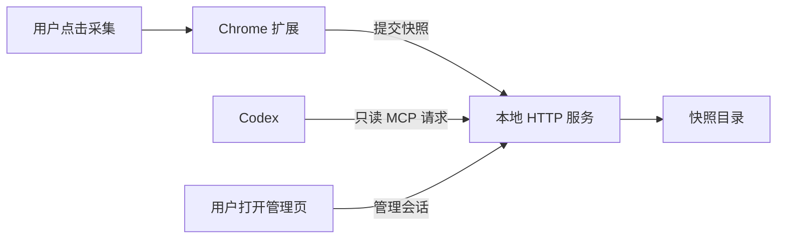
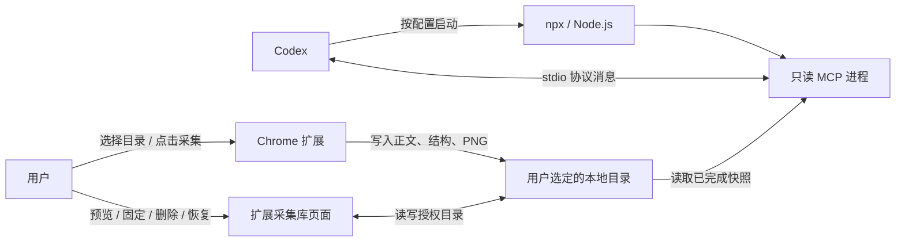

# 面向 AI 的网页采集器：从本地服务到文件目录与只读 MCP

这个项目解决一个具体问题：用户能在浏览器中看到网页，希望把其中的正文、表格和图片交给 AI 阅读，但不需要 AI 操作网页。

最终实现的主线是：**用户点击 Chrome 扩展采集，扩展把多格式快照写到用户选定的目录；Codex 按配置启动一个只读 MCP 进程，读取同一批文件。** 采集和阅读可以在不同时间发生，双方不必同时运行。

本文从初始方案更新为截至 **2026-10-16、0.5.0 版本**的实现复盘。保留需求如何推动架构变化，以及每一阶段实际验证到了哪里；不包含具体业务、真实文档、账号或私有部署信息。初次收录日期仍为 2026-10-15。

## 起因：网页可见，不等于 AI 已经取得材料

项目起点是对[浏览器站点安全检查与本地权限边界](/knowledge/ai-engineering/codex-browser-site-safety-policy)的调研。网站登录态、用户授权和浏览器工具的访问规则各有职责：用户已经登录，不代表独立 HTTP 抓取程序能取得同一份页面，也不代表 Agent 的浏览器工具一定允许操作这个来源。

实际需求因此被收敛为一个材料交接工具：

- 用户自己打开并决定采集哪个页面。
- 扩展固定执行采集流程，尽量保留正文、结构和视觉证据。
- AI 只查询已保存快照，不获得点击、输入、跳转或重新采集工具。
- 一份材料可以重复阅读，并能追溯到采集时间和具体版本。

已有官方 API、导出功能或连接器能可靠取得内容时，它们仍然更合适。这个项目补足的是“用户有权查看和导出，但缺少方便的材料交接方式”的场景。用户主动导出快照也不改变其他工具的访问规则，不能用它让 AI 间接执行被禁止的浏览器动作。

最初设想的“中介”包含 Chrome 扩展、本地 HTTP 接收服务和只读 MCP。这个方案很适合先验证链路；后续最大的变化，是发现两端真正需要共享的是**已保存的数据**，并不需要保持实时连接。

## 迭代过程：每次改变解决了什么

| 阶段 | 暴露的问题 | 实际调整 | 留下的结论 |
| --- | --- | --- | --- |
| 0.1：HTTP 原型 | 登录网页的内容难以交给 AI；文本与截图各有缺失 | 扩展采集正文、结构和当前视口截图，提交本地服务，由四个只读 MCP 工具读取 | 先证明采集、落盘和读取能闭环 |
| 0.2：滚动采集 | 单张截图只有当前可见区域，长文下方内容丢失 | 识别主要滚动区，从顶部逐段截图并合并新出现的 DOM 内容，结束后恢复位置 | API 调用成功不等于材料覆盖完整 |
| 0.3：采集库 | 用户不知道数据在哪、有多少、该让 AI 读哪份，也无法预览和清理 | 增加列表、正文/结构/截图预览、固定、删除、恢复、路径和保留期限设置 | 管理和交接入口是最小可用流程的一部分 |
| 0.3.1：工具栏菜单 | 点击图标直接采集，管理入口难以发现 | 图标打开菜单，“打开采集库”和“采集当前页”分成独立操作 | 一键入口也要让用户清楚它会做什么 |
| 0.4：自动启动 | 打开管理页仍需要手工运行命令、建立管理会话 | 使用 Native Messaging 与系统登录自启组件，点击扩展时确保服务启动并取得管理链接 | 减少了日常命令，但首次安装仍包含本机组件 |
| 0.4 后续修正 | 删除按钮只在预览区，窄窗口下很难发现 | 每份列表项直接提供固定和删除；修正窄屏布局 | 功能存在与用户找得到是两种验收 |
| 0.5：文件目录方案 | 为什么还要安装和维护一个常驻服务？ | 扩展直接读写授权目录；MCP 打包为 npm 包，由 Codex 通过 npx 启动 | 通过文件解耦采集和阅读，可以去掉 HTTP 与自启组件 |
| 0.5 发布验证 | 本地能运行，不代表别人能通过包名使用 | 发布公开 npm 包，以空缓存下载并完成真实 MCP 调用 | 分发需要独立于源码开发环境验收 |

另一个需求变化是数据保存方式：初期考虑过独立数据仓库，随后明确取消采集数据的 Git 推送。截图会放大历史体积，删除工作目录中的文件也无法删除 Git 历史副本。最终将产品代码版本管理与本地材料保留策略分开。

## 为什么最终去掉本地 HTTP 服务

### HTTP 方案能工作，但需要管理更多状态

早期链路是：



服务负责接收、校验和持久化快照，同时承载管理页与 MCP。为避免权限混用，扩展上传、MCP 读取和用户管理使用不同凭证；管理操作还需要会话和同源校验。回环监听并不自动免除这些要求，MCP 的 HTTP 传输规范也要求验证 Origin，并建议本地绑定回环地址及提供认证。[MCP 传输规范](https://modelcontextprotocol.io/specification/2025-11-25/basic/transports)

管理功能加入后，用户还必须理解进程是否启动、管理会话是否有效、端口是否可用、升级后是否需要重装本机组件。这些状态与“保存一份网页材料”本身关系不大，却成了日常使用成本。

### Chrome 扩展为什么不能自己监听一个端口

普通 Manifest V3 扩展没有可直接使用的通用 TCP/HTTP 监听 API。扩展能向服务发请求，不等于能充当接受连接的本机服务器。容易搜到的 `chrome.sockets.tcpServer` 属于 Chrome Apps API，不能把它当成普通扩展的能力。[Chrome Apps TCP Server 文档](https://developer.chrome.com/docs/apps/reference/sockets/tcpServer)

扩展 Service Worker 的生命周期也不适合被当作常驻守护进程，但休眠不是唯一原因：即使让页面一直开着，也不会因此获得监听端口的 API。

Native Messaging 可以让扩展调用**已经安装并注册的本机程序**。Chrome 根据 host 配置启动该程序，再通过消息通道通信；它不是让扩展自行安装并执行任意二进制。[Chrome Native Messaging](https://developer.chrome.com/docs/extensions/develop/concepts/native-messaging)

0.4 因此实现了本机 host 和 macOS 登录自启：点击扩展可以自动进入管理页，实际体验得到改善。但它解决的是启动问题，仍有安装、路径绑定和升级维护成本。

### 重新审视需求后，文件就足够了

这个产品不要求 AI 实时控制浏览器，也不要求采集时 Codex 必须在线。只要扩展能写出一份完整快照，MCP 稍后读到它，目标就成立。

| 方案 | 额外成本 | 对本项目的判断 |
| --- | --- | --- |
| 本地 HTTP + 本机自启 | 安装器、端口、凭证、会话和进程恢复 | 已跑通，作为旧版兼容路径保留 |
| 扩展内部存储或 OPFS | Node 进程不能按稳定的用户文件路径直接读取 | 适合浏览器私有数据，不适合作为本次交接目录 |
| 上传云端存储 | 账号、网络、同步与数据外发处理 | 当前同机阅读需求没有必要引入 |
| 用户授权目录 + stdio MCP | 首次选目录、填写 MCP 路径、安装 Node.js | 采用；把交接边界变成可检查的文件格式 |

OPFS 的数据属于来源私有存储，不承诺映射成用户可直接操作的一组同名磁盘文件，因此不能让外部 Node 进程猜浏览器内部存储布局。[Chrome File System Access 说明](https://developer.chrome.com/docs/capabilities/web-apis/file-system-access#accessing-the-origin-private-file-system)

## 0.5 架构：浏览器写文件，MCP 只读文件



三个组件的职责很明确：

- **扩展**负责页面采集和文件保存；只有用户点击采集按钮才开始滚动。
- **扩展内管理页**负责预览、选择材料和数据生命周期管理。
- **MCP 进程**负责向 AI 提供已有快照的列表、正文、搜索和图片。

新链路没有本地 HTTP 端口、管理会话、上传密钥或登录自启组件。仍然有一个由客户端启动的本地 MCP 进程，也仍然需要 Node.js；优化掉的是用户单独安装和维护常驻服务的步骤。

### Codex 如何知道程序在哪里

Codex 不会自行搜索硬盘寻找 MCP。用户在配置中声明启动命令、npm 包及数据目录。Codex 建立 MCP 连接时启动命令；`npx` 解析包名、按需下载并缓存指定版本，再运行包的可执行入口。

stdio 模式通过子进程的标准输入和标准输出交换 JSON-RPC 消息，不需要监听端口。协议运行时 `stdout` 只能输出 MCP 消息，日志应写入 `stderr`。[MCP stdio 规范](https://modelcontextprotocol.io/specification/2025-11-25/basic/transports#stdio)

这也解释了两个看似相反的说法为什么同时成立：扩展不能直接启动一个回环服务，而桌面 MCP 客户端可以启动一个本地进程。两者运行在不同的能力环境里。

## 采集原理：多种表示，分别记录范围

### 正文、结构和图片各自承担什么

| 表示 | 主要用途 | 不能据此推断的事情 |
| --- | --- | --- |
| Markdown | 默认阅读与检索，保留段落、列表、代码等 | 不能假定复杂版式无损保留 |
| 结构化块 | 标题层级、表格行列、链接和图片说明，便于定位 | 检测到块数量不等于取得文档正文 |
| 有序 PNG | 保留 Canvas、图表和排版的视觉证据 | 截图可读不等于文字已进入全文索引 |
| 覆盖元数据 | 记录截图顺序、滚动位置、停止原因、警告 | 到达底部不等于全部内容已采全 |

扩展使用 `activeTab` 与 `scripting` 注入打包好的采集逻辑。内容提取优先寻找文章或主内容，补充可见文字，并保留可提取的标题、表格、列表、代码、链接和图片信息。HTML 用于提取和转换，不保存成可以重放脚本的应用副本。

`activeTab` 本身不是只读权限；只读产品边界仍依靠固定的采集代码，以及 MCP 中不提供浏览器操作接口。该权限的触发与范围见 [Chrome activeTab 文档](https://developer.chrome.com/docs/extensions/develop/concepts/activeTab)。

### 为什么单张截图不够

`captureVisibleTab()` 获取活动标签页的可见区域，不会自动滚到文档下方。[Chrome Tabs API](https://developer.chrome.com/docs/extensions/reference/api/tabs#method-captureVisibleTab)

初版在普通 DOM 页面上能提取视口外已加载文字，但图片只保存当前视口。在 Canvas 编辑器里，正文可能根本不在普通 DOM 中，于是“得到不少文字块”仍可能只是取得了工具栏和评论区。

这次问题通过真实材料暴露出来：画面里能看见的正文短句，在提取结果中检索不到。因此不能只以接口返回成功、块数量非零或图片文件存在作为验收条件。

### 滚动采集怎样执行

0.2 以后采用用户启动的固定流程：

1. 检查页面、当前标签页和保存权限，避免采集完才发现无法保存。
2. 识别主要正文滚动容器，记录原始位置，再从顶部开始。
3. 等待渲染，提取当前内容，并保存一张视口截图。
4. 每次前进约 70% 可见高度，保留相邻图片重叠，合并新出现的内容块。
5. 记录每张图片对应的滚动位置、视口和内容区矩形。
6. 到底、达到限额或受到用户干预时结束；尝试恢复原位置并记录结果。

复杂编辑器可能同时存在正文和评论滚动区，选错容器会把“采完整个评论栏”误当成“采完整篇文档”。因此验证夹具需要同时包含内层滚动区、Canvas 和更长的侧栏，检查实际移动的是哪一块。

当前实现限制单次最多 30 张、2 分钟，并限制图片编码总量和快照体积。切换标签页或导航会放弃不匹配的快照；用户滚动、视口变化和截图失败会产生明确停止原因。分段图片保留为序列，没有强制拼成一张超长图。

截图并非同一时刻的冻结画面，DOM 去重也可能合并原文中本来就重复的段落。懒加载、自绘滚动条、横向内容和多个独立正文区域仍可能造成缺口。

因此，`reachedEnd` 只表示**所选滚动区到达底部**。当前完整性仍标为 `partial-or-unknown`，Canvas 文字没有新增 OCR，iframe 内部和远程图片原图也不在本版提取范围内。

## 目录授权：先验证最容易卡住的使用体验

改成文件目录前，先做了独立验证页，测试选择目录、读写、页面重开和 Chrome 完整重启。因为如果每次采集都需要重新选择目录，新方案会把服务启动成本换成另一种操作负担。

### 句柄保存与权限保存是两件事

可见的扩展页面在用户点击时调用 `showDirectoryPicker({ mode: 'readwrite' })`，得到目录句柄，并把句柄保存在扩展自己的 IndexedDB。下次恢复句柄后，先调用 `queryPermission()`：

```text
没有句柄                 → 提示选择目录
有句柄且 granted         → 可以采集、保存和管理
有句柄但 prompt / denied → 在管理页提供重新授权入口
```

目录句柄可以序列化到 IndexedDB，但这不等于权限永远有效；请求选择或重新授权应由可见页面中的用户操作触发。[File System Access 的句柄与权限](https://developer.chrome.com/docs/capabilities/web-apis/file-system-access#stored-file-or-directory-handles-and-permissions)

Chrome 从 122 起提供更持久的文件权限体验，但权限仍可能因用户撤销、配置变化或重装而失效。项目的扩展最低版本设为 Chrome 122；真实重启验证证明的是当前环境可以保持授权，不是所有环境都永久授权。[Chrome 持久权限说明](https://developer.chrome.com/blog/persistent-permissions-for-the-file-system-access-api)

实现上的关键是：**先确认能够保存，再开始滚动。** 后台发现权限不足时不尝试弹授权窗口，而是引导用户进入管理页。取消选择目录则保留原来的库。

### 为什么还要手填一次路径

浏览器拿到的是目录句柄和名称，不提供可直接交给 Node.js 的系统绝对路径。即使能解析目录中的相对位置，也不能推出它位于磁盘上的哪个完整路径。

因此首次设置仍有两步：在扩展中选目录，再在 MCP 设置中填写同一目录的完整路径。管理页会生成一个库 ID，并把它带入 MCP 配置；启动时校验库标记，避免两个同名文件夹被误认为同一份材料。

早期本机服务版使用操作系统的应用数据目录作为默认位置。浏览器直写版则改为用户选定的普通文件夹，不能静默复用受保护的系统目录。目录选择器可以从“文稿”开始，正式材料应使用稳定的专用文件夹；临时目录只用于验证。

## 文件格式与读写一致性

文件目录是扩展和 MCP 的共同契约，而不是浏览器内部实现细节：

```text
<用户选择的目录>/
  .page-capture-library.json  # 格式版本、库 ID、保留天数
  captures/<capture_id>/
    capture.json             # 来源、正文、结构、覆盖说明、截图索引
    content.md               # 便于直接阅读的正文
    viewport.png             # 第一张截图
    page-0002.png            # 后续截图
    management.json          # 固定与逻辑删除状态，按需创建
```

写入顺序是先保存图片和正文，最后保存 `capture.json`，把它作为完成标记。MCP 不把没有完成标记的目录列为有效快照；写入失败时尝试移除本次未完成目录。扩展内的写操作通过同一命名锁串行化。

这是一种针对当前快照格式的提交约定，不是通用多文件事务。系统崩溃或外部程序改写文件仍可能留下损坏数据，所以读取端还要检查格式、大小、记录 ID，以及图片的字节数和 SHA-256。校验值用于发现图片损坏或不匹配，不是对网页来源真实性的签名证明。

MCP 按经过校验的快照 ID 和图片 ID 找文件，不接受工具调用者传入任意路径。读取实现还包含针对目录、符号链接和文件体积的检查。扩展管理与 Node 读取共用格式定义，避免两端逐渐演化出不兼容的快照解释。

## 采集库为什么必须包含预览和管理

用户采完之后首先要确认保存了什么，然后才能决定交给 AI 哪份材料。管理页提供标题、来源、时间、空间占用、截图数量和覆盖警告；预览分为正文、结构和截图三个视图。

正文按文本显示，结构按 JSON 显示，截图加载已保存的 PNG，不执行原页面 HTML、脚本或远程图片。每个列表项直接暴露固定和删除入口，避免必须先选中并在宽预览区内寻找按钮。

### 保留策略由扩展执行

- 默认保留天数为 0，即一直保留；用户可改为最近 30 天。
- 按本地保存时间判断过期，固定快照不受自动过期影响。
- 删除先写入逻辑回收站状态，MCP 的四个工具均不再提供该快照。
- 回收站保留 7 天，期间可恢复；恢复后自动固定，避免马上再次过期。
- 打开采集库、采集后及 Chrome 运行期间每小时检查清理。

Chrome 关闭或目录授权失效时，清理暂停，之后恢复执行。回收站宽限期内仍然占空间，30 天保留也不是精确的磁盘容量上限。MCP 不承担清理任务，不能因为 AI 读一次材料就触发删除。

“选择其他目录”只切换库，不自动迁移旧文件。迁移和切换是两种操作，需要分别说明和验证。

### “最新一份”与唯一快照 ID

“读取最新快照”适合刚采完一份材料的简单场景：先调用列表工具，按本地保存时间取最新项，核对标题和来源，再读取。

多文档或重复采集时，“最新”会随着后续操作变化。因此管理页提供“复制 Codex 指令”，把唯一快照 ID 放进指令中。ID 是阅读任务的稳定引用，标题只是辅助辨认。

推荐让 AI 先检查覆盖信息，再读正文、搜索相关块，最后按需看截图。不要一开始把全部图片和 JSON 一起塞进模型上下文，也不要只读 Markdown 就宣称已读完整份 Canvas 文档。

## 只读 MCP 的边界与 npm 分发

当前 MCP 只有四个工具：

| 工具 | 功能 |
| --- | --- |
| `list_captures` | 按标题或来源筛选快照，分页返回元数据 |
| `read_capture` | 读取元数据、正文或结构，支持分页和块定位 |
| `search_capture` | 在指定快照的文本块中搜索关键词 |
| `read_capture_image` | 根据图片 ID 返回一张已保存 PNG |

没有抓取 URL、控制 Chrome、执行 JavaScript、删除数据或任意文件读取工具。`readOnlyHint` 只是协议提示，实际只读由工具实现和读取路径承担。这个实现边界也不等于给 Node 进程施加了操作系统级只读沙箱，更不会限制 Agent 通过其他工具取得的能力。

### 发布内容与本地材料分开

截至记录日，`page-capture-bridge-mcp@0.5.0` 已发布到[公开 npm](https://www.npmjs.com/package/page-capture-bridge-mcp)。包只包含可执行入口、README 和第三方许可文件，依赖已捆绑，不包含扩展、HTTP 服务、采集数据或凭证。

发布流程先构建，再打出 `.tgz`，检查精确文件白名单，最后发布同一个归档。发布成功后，从空 npm 缓存按包名下载，并连接真实 stdio 客户端验证四个工具。这样可以发现“开发机依赖齐全才能运行”“包里漏文件”“镜像未同步”等本地测试发现不了的问题。

目前使用维护者手动发布命令，未配置自动发包 CI；版本固定到 `0.5.0`。公开可下载不等于已经采用开源许可证，当前项目标记仍为 `UNLICENSED`。

### 一次配置，后续由客户端启动

下面是通用配置示例，路径和库 ID 必须换成管理页生成的实际值：

```toml
[mcp_servers.page_capture]
command = "npx"
args = [
  "-y",
  "--registry=https://registry.npmjs.org/",
  "page-capture-bridge-mcp@0.5.0",
  "--data-dir", "/path/to/project/captures-library",
  "--library-id", "REPLACE_WITH_LIBRARY_UUID"
]
startup_timeout_sec = 60
```

Codex 支持通过 `config.toml` 配置 stdio 启动命令和参数；添加配置后重新连接 MCP。这里显式指定公开 registry，避免本机镜像尚未同步首发版本。[Codex MCP 配置文档](https://learn.chatgpt.com/docs/extend/mcp)

`npx` 首次运行可能需要联网并写入包缓存。“只读”指 MCP 对采集库的业务操作，不意味着安装器不会写磁盘。使用者需要 Node.js 22+，且执行 MCP 的主机能够访问所选目录；远程主机不会因为路径字符串相同就自动获得本机文件。

## 当前基本使用流程

1. 安装 Chrome 扩展。当前仍是加载构建产物的开发版分发方式，尚未完成 Chrome Web Store 安装流程。
2. 打开扩展采集库，选择稳定的保存目录并授权。
3. 在存储设置填入目录完整路径，复制带 npm 包名和库 ID 的 MCP 配置，添加到 Codex 并重新连接。
4. 在目标页面点击“采集当前页”，保持页面前台，等待保存结果。
5. 打开采集库检查正文、结构、截图及覆盖警告，复制指定快照的 Codex 指令。
6. 让 Codex 通过 MCP 读取和分析材料。

前 3 步属于首次配置。此后采集不要求 Codex 在线；读取已有材料也不要求 Chrome 保持打开。权限失效时再进入管理页重新授权。

从旧 HTTP 版本升级时，应先备份并核对旧材料，再验证新文件库和 stdio 配置，最后卸载旧启动组件。发布新 npm 包不会自动迁移已安装客户端，也不会自动修改现有 MCP 配置。此次验证完成了新链路，原有安装的完整迁移仍是独立工作。

## 实际验证到哪里

以下是开发和验收记录的脱敏汇总，保留结果及限制，不公开样本正文、图片和原始日志。

| 验证层 | 已有证据 | 不能由此推出的结论 |
| --- | --- | --- |
| 普通 DOM 夹具 | 正文、标题、列表、表格、代码、链接与截图可以保存和读取 | 不代表所有站点都能正确提取 |
| Canvas 编辑器样本 | 画面可读，但画面中的正文短句未进入 Markdown 检索 | 截图路径成功，全文检索仍有缺口 |
| 滚动改进 | 一个长文样本产生 8 张有序截图，报告到达所选底部并恢复位置；图片经 MCP 读取核验 | 不代表包含所有未展开、未加载或独立区域 |
| HTTP 管理与启动阶段 | 管理页、凭证隔离、会话和本机唤起完成测试；用户确认能直接进入管理页 | 不代表取消了首次本机组件安装 |
| 文件目录授权 | 用户完成选择、读写、页面重开和完整重启 Chrome；重启后报告 `granted`，再次读写成功 | 仅证明当前配置，没有跨平台永久授权保证 |
| 文件目录实际采集 | 用户完成扩展操作；检查真实文件，并以 MCP 读取正文、搜索和图片，正文一致、图片哈希一致 | 与合成夹具测试不同，仍不能证明所有编辑器保真 |
| 管理与失败路径 | 自动测试覆盖删除恢复、保留策略、权限失效、保存失败和文件互读；0.5 回归记录为 38 项通过 | 本次真实采集未独立取得删除恢复的落盘证据，不把自动测试写成实机验收 |
| npm 分发 | 公开 registry 可查询；空缓存 npx 下载后四个只读工具可用，能读取真实快照 | 不代表扩展已经上架，也不代表旧配置已自动切换 |

比较有效的验收方法是把“调用成功”拆成多项：材料确实保存、文字与画面匹配、图片不是空白、选中了正确滚动区、停止原因如实记录、权限失效可恢复、发布包能脱离源码运行。任何一个成功徽标都不能替代这些证据。

## 可复用的经验与后续方向

**先找稳定的交接对象。** 如果生产者和消费者只需交换完成态材料，文件格式可以比常驻服务更简单。只有出现多设备实时共享、集中权限或多人协作需求时，再重新评估服务化。

**把安装体验纳入架构决策。** 本机自启改善了日常操作，却没有解决首次安装成本。删除非必要连接层，比继续隐藏启动命令更彻底。

**先验证授权和重启，再做大规模重构。** 文件 API 可用只证明一次操作成功；句柄恢复、权限检查和重新授权入口，才决定产品能否持续使用。

**完整性需要作为数据保存。** 正文、截图与滚动范围分别描述，未知就保留未知。快照应让 AI 和人都能发现缺口，而不是给出无法证明的“全文采集成功”。

**预览与唯一 ID 是交接协议的一部分。** 用户看见采集结果并选定快照，能减少 AI 读错材料和误用旧版本；列表中可见的管理按钮则让长期存储可维护。

**只读应落实在工具和代码路径。** 管理操作留在用户界面，MCP 不负责采集和清理；网页中的文字、链接和图片始终是待分析资料，不能被当作新的执行授权。

当前仍值得继续改进的方向包括：更可靠的滚动区选择、可追溯的 OCR、图文关联、重复段落保真、容量上限、跨平台目录授权测试，以及扩展的正式分发。OCR 和摘要应作为带方法和版本的派生层，不能覆盖原始截图和正文。

本地保存也不等于本地推理：MCP 把材料返回给云端模型后，内容会进入模型上下文。清理 URL 中的常见凭证参数，不能自动清除正文或截图里的敏感信息；材料是否适合交给模型仍需由用户根据使用环境判断。

## 公开参考

- [Chrome：activeTab](https://developer.chrome.com/docs/extensions/develop/concepts/activeTab)
- [Chrome：Tabs API](https://developer.chrome.com/docs/extensions/reference/api/tabs)
- [Chrome：扩展 Service Worker 生命周期](https://developer.chrome.com/docs/extensions/develop/concepts/service-workers/lifecycle)
- [Chrome：Native Messaging](https://developer.chrome.com/docs/extensions/develop/concepts/native-messaging)
- [Chrome Apps：TCP Server API](https://developer.chrome.com/docs/apps/reference/sockets/tcpServer)
- [Chrome：File System Access API](https://developer.chrome.com/docs/capabilities/web-apis/file-system-access)
- [Chrome：File System Access 持久权限](https://developer.chrome.com/blog/persistent-permissions-for-the-file-system-access-api)
- [MCP：传输规范](https://modelcontextprotocol.io/specification/2025-11-25/basic/transports)
- [Codex：MCP 配置](https://learn.chatgpt.com/docs/extend/mcp)
- [公开 npm 包：page-capture-bridge-mcp](https://www.npmjs.com/package/page-capture-bridge-mcp)
