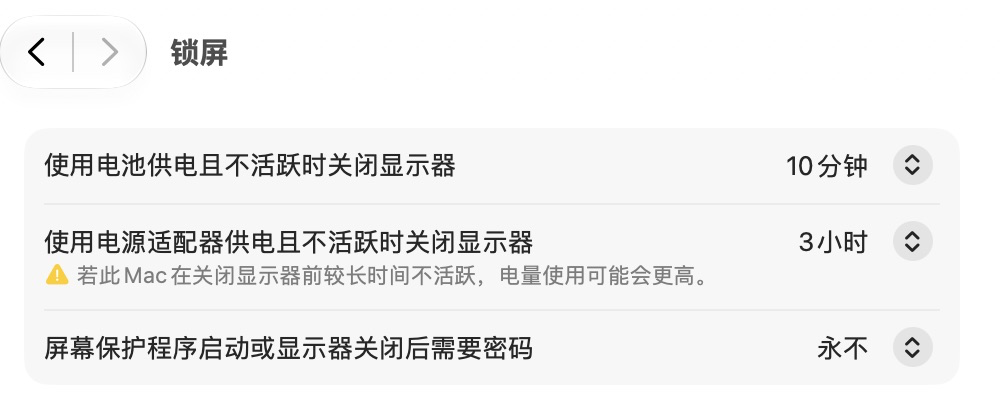

# MacBook 远程开发机：Codex 唤屏后直接操作桌面

远程开发除了 SSH、构建和后台任务，还可能需要 Codex 点击桌面 App、读取系统设置、操作浏览器和截图。如果唤醒显示器后停在密码界面，这些交互就需要人先用远程桌面完成解锁。

这次实践复核两个设置：**启动屏幕保护程序设为“永不”**，**屏幕保护程序启动或显示器关闭后需要密码设为“永不”**。随后进行了约七小时的观察：自然关屏后的两次检查都能恢复截图、输入和点击，本轮无需人工输入系统密码；但首次读取均出现过自动解锁失败，系统状态变化后正常重读才继续成功。因此，配置复核之外，还需要验证会话恢复与真实键鼠操作。

2026-11-01 在 macOS 27.0.1 上复核，两项已经是“永不”，接电熄屏时间随后按使用需要从 3 小时调整为 30 分钟，并重新截图、通过 `pmset` 复核；本次没有修改认证策略。同一会话中，Codex 已能获取访达和 Chrome 的画面，并通过 Computer Use 点击系统设置、打开相关页面。这里记录的是这台机器、这个登录会话的结果。

本文属于 [MacBook 远程开发机系列](./macbook-remote-development-setup.md)的桌面自动化补充实践。[供电、熄屏与锁屏篇](./macbook-remote-development-power-and-sleep.md)保留“熄屏后立即要求密码”的日常远程开发方案；需要免人工介入的桌面操作时，按本文选择相应策略。

## 分清屏保、熄屏、锁屏与系统睡眠

| 状态 | 影响 | 本实践的处理 |
| --- | --- | --- |
| 屏幕保护程序 | 闲置后显示屏保，可能增加回到工作界面的步骤 | 自动启动时间设为“永不” |
| 显示器关闭 | 屏幕熄灭，后台进程是否继续运行还取决于系统睡眠设置 | 可以保留熄屏计时；本机接电时为 30 分钟 |
| 熄屏或屏保后要求密码 | 返回桌面前需要认证 | 密码要求设为“永不” |
| 系统睡眠 | 可能暂停计算和影响远程连接 | 接电且显示器关闭时，防止自动进入睡眠 |

屏保设为“永不”不会自动取消密码要求，也不会保证系统持续运行。熄屏计时可以独立设置，无需为此让显示器一直亮着。Apple 分别说明了 [屏幕保护程序的启动条件](https://support.apple.com/zh-cn/guide/mac-help/mchl4b68853d/27/mac/27)和 [唤醒时的密码要求](https://support.apple.com/zh-cn/guide/mac-help/mchlp2270/27/mac/27)。

## 配置与复核步骤

所有操作都在承担远程工作的 Mac 上进行。先读取现状，已经符合要求时直接保存证据即可。其他 macOS 版本的入口可能不同，以选项含义为准。

### 1. 屏幕保护程序设为“永不”

在本机 macOS 27.0.1 中，打开 **系统设置 → 墙纸 → 屏幕保护程序…**，检查 **启动屏幕保护程序…** 为 **永不**，然后点 **完成**。


### 2. 熄屏或屏保后不要求密码

打开 **系统设置 → 锁屏**，检查 **屏幕保护程序启动或显示器关闭后需要密码** 为 **永不**。



这里“不设置解锁密码”具体指这个选项。它不等于删除 Mac 账户的登录密码，也不等于配置了开机自动登录。若首次配置时系统要求身份验证，由账户持有人完成。

截图中的电池 10 分钟、接电 30 分钟是本机复核值，读者按使用需要选择熄屏时长。它们不需要与屏保或密码选项一起设为“永不”。

### 3. 保持接电运行，避免系统因闲置进入睡眠

打开 **系统设置 → 电池 → 选项…**，确认 **使用电源适配器供电且显示器关闭时，防止自动进入睡眠**已开启。


本机同时将 **唤醒以供网络访问**设为 **仅使用电源适配器时**。网络唤醒是辅助设置，持续运行仍依赖供电、开盖与防闲置睡眠等条件，见 [供电篇](./macbook-remote-development-power-and-sleep.md)。

可以在目标 Mac 的终端运行只读检查：

```sh
sw_vers
pmset -g batt
pmset -g custom
```

本次结果摘要：

| 项目 | 2026-11-01 复核值 |
| --- | --- |
| 系统版本 | macOS 27.0.1 |
| 当前供电 | AC Power，已连接电源适配器 |
| 接电闲置系统睡眠 | `sleep = 0` |
| 接电闲置显示器关闭 | `displaysleep = 30`，即 30 分钟 |
| 屏保自动启动 | GUI 显示“永不” |
| 熄屏或屏保后需要密码 | GUI 显示“永不” |

`pmset` 用于核对电源字段，屏保和密码要求以对应 GUI 为证据，不能用 `sleep = 0` 推断桌面已经解锁。

## 本次实测证明了什么

| 检查 | 实际结果 | 结论 |
| --- | --- | --- |
| 两项“永不”是否保存 | 通过系统设置读取并截图确认 | 配置已符合本实践 |
| 接电时是否防闲置睡眠 | GUI 开关开启，`AC Power` 下 `sleep = 0` | 配置符合持续运行的要求 |
| 读取桌面 App 画面 | 取得访达和 Chrome 当前窗口截图 | 当前登录会话的画面读取可用 |
| 发送桌面交互 | 向访达发送 Escape；点击系统设置的锁屏、墙纸、电池及相关弹窗，并读取新状态 | 当前登录会话的按键、点击和状态读取可用 |
| 是否需要人工先解锁 | 上述操作过程中未要求人通过远程桌面输入密码或点击 | 本次桌面交互可直接完成 |
| 完整熄屏到唤屏循环 | 记录三轮约 30 分钟自然关屏，两次关屏后的恢复及实际输入通过 | 首次读取可能报锁定，需结合状态变化复核，详见下节 |
| 重启、退出登录、手动锁屏或合盖后的恢复 | 本轮未进行 | 不在此次结论范围内 |

最初的桌面操作验证后，又增加了独立的显示器睡眠状态、HID 闲置计时与会话状态记录，并在自然关屏后验证真实输入。没有做两项设置的开关对照，因此这些结果支持本机当前登录会话中的可恢复操作，不能据此断言两个“永不”是所有机器唯一或充分的条件。

原始浏览器画面包含私人页面，本篇只纳入设置区域截图。图片已裁去无关内容并移除元数据，未收录账户、地址、浏览记录或原始窗口画面。

## 自然关屏后的长时间复测

为区分“可以截图”和“确实可以操纵”，后续计划在请求后 1、3、8 小时检查。用户在约 7 小时处提出使用电脑，因此完成提前最终检查后结束，8 小时检查未执行。每次先保存只读系统状态，再调用 Computer Use；可访问桌面时，在本地测试页输入本次独有文字、点击按钮，核对页面回显并保存新截图。

检查点按同一个请求起点计时；每次实际输入都会重置闲置计时。因此，下表的检查间隔与连续闲置时间需要分别记录，不能把 8 小时检查写成连续闲置 8 小时。

| 检查点 | 操作前连续闲置 | 实际结果 | 解释边界 |
| --- | --- | --- | --- |
| 请求后 1 小时 | 约 7 分 48 秒 | 新截图、唯一文字输入、按钮点击与页面响应成功 | 中途记录到额外 Computer Use 服务唤屏，触发来源未确定；不作为连续闲置一小时的证据 |
| 请求后 3 小时 | 约 1 小时 59 分 39 秒 | 首次读取报锁定及自动解锁失败；系统状态变化后再次正常读取可用，随后截图、输入与点击成功 | 本轮没有输入系统密码或改变认证设置；保留首次失败与恢复成功两份证据 |
| 约请求后 7 小时的提前最终检查 | 约 3 小时 57 分 40 秒 | 首次仍报锁定，系统状态变化后正常重读可用；截图、唯一输入和点击成功 | 用户要使用电脑，因此提前结束本轮 |
| 原定请求后 8 小时 | 未执行 | 取消 | 不能用提前检查替代八小时结果 |

被动采样已观测到三轮约 30 分钟的自然关屏。采样期间闲置计时持续累计，采样进程没有持有阻止睡眠的请求，说明它没有阻止本次自动关屏。本次主动 Computer Use 检查触发了唤屏和短暂的防止显示器睡眠请求，实际输入也重置了闲置计时；两者需要分开记录。

### 首次提示锁定后，先复核是否已经恢复

3 小时检查前，主显示器处于睡眠，系统报告屏幕锁定。第一次 Computer Use 读取返回自动解锁失败，但随后只读采样显示屏幕已亮、锁定标志消失，且没有新的普通键鼠输入。针对这一状态变化，再次正常读取桌面成功，实际输入与按钮点击也成功。

提前最终检查在连续闲置约四小时后，再次复现了同样的首次报错与正常重读恢复过程。两次操作均未输入系统密码，也未更改认证设置。

这提示可能存在唤醒与会话状态更新的时序差异，尚不能确定工具内部原因。可重复的处理顺序是：

1. 保留首次错误，不立即向仍报告锁定的桌面发送输入。
2. 只读复核显示器与会话状态。锁定字段缺失本身不证明已能操纵桌面。
3. 有明确状态变化时，再正常读取一次 Computer Use 状态；只有它返回可用桌面时，才连接应用进行操作。
4. 用新文字和按钮响应验证恢复，避免把旧截图或“调用未报错”当成成功。
5. 若持续锁定或正常读取仍失败，记录阻断，转入相应认证与权限排查，不改用其他技术强行发送输入。

这条流程用于识别已经发生的正常恢复，不会代替账户认证，也不保证所有锁定场景都能恢复。

### 区分自然关屏与显式锁屏

同一轮排查里，系统日志记录了两种入口：一次历史事件来自直接锁屏请求，后续连续闲置的关屏事件来自显示器变暗/关闭。它们不是同一个触发条件，不能用“屏保永不”排除所有锁屏入口。

显式锁屏仍需核对苹果菜单、快捷键、触发角以及远程桌面断开行为。Apple 说明了 [锁定 Mac 屏幕的入口](https://support.apple.com/zh-cn/guide/mac-help/mchl8e8b6a34/27/mac/27)；Screens 则提供 [断开连接后的动作](https://help.edovia.com/en/screens-5/features/on-disconnect-actions)，并说明部分连接场景会 [恢复连接前的状态](https://help.edovia.com/en/screens-5/troubleshooting/log-in-twice-mac)。本次日志不能确定历史直接锁屏请求由哪个应用发出。

Computer Use 另有自己的锁定使用规则。按 [官方 Locked use 说明](https://learn.chatgpt.com/docs/computer-use)，检测到本机键鼠输入时可能重新锁定并暂停自动解锁，直到手动解锁；应核对授权状态和具体场景，不能只调整 macOS 屏保。本轮没有更改锁定使用配置，也没有证据证明它就是本次历史锁屏的原因。

Touch ID 也存在必须重新输入密码的条件，但那是生物识别认证的限制，不能据此认定 Mac 每隔几天会主动锁屏，见 [Apple 的 Touch ID 认证条件](https://support.apple.com/zh-cn/102356)。

### 以后监控时保存什么

- 记录显示器是否睡眠、会话锁定标志、HID 闲置秒数和 `pmset -g assertions`；分别检查阻止主机睡眠与阻止显示器睡眠的请求。
- 记录系统日志中的锁屏入口及唤屏请求，避免把显式锁屏、正常关屏和工具唤屏混成一个事件。
- 采样程序不截图、不发送输入、不创建常亮请求。只有检查点才实际访问桌面，并明确标出它会改变现场。
- 如闲置计时下降，结合分类型输入事件判断；空事件不等于人在敲键盘，活动来源名称也不能证明所有后续事件都来自同一进程。
- 未公开字段可能包含编码值。异常时间戳保留原值并标记未知，以带时间戳的系统日志核对事件时间，不自行套用 Unix 秒。
- 原始日志、完整浏览器截图和私人窗口信息留在本机；公开实践仅保存脱敏摘要及经过处理的必要截图。

## 以后如何重复验收

1. **先确认运行条件**：目标 Mac 已登录且接电运行，远程任务入口在线，Computer Use 的必要权限已由用户授权；先保存一张当前画面。
2. **复核三个配置**：屏保“永不”、熄屏或屏保后密码要求“永不”、接电防闲置睡眠开启；记录实际熄屏时长。
3. **让显示器按计时正常关闭**：保持开盖接电，不用手动锁屏、合盖或系统睡眠代替这一步；停止本机输入和可能重置闲置计时的远程操作。
4. **从实际远程入口发起任务**：先保存只读现场，再请 Codex 正常读取桌面。首次提示锁定时按上节流程复核；只有桌面状态可用后，再在本地测试页输入本次唯一标记并点击验证按钮。
5. **确认返回结果**：画面能获取、点击后的页面正确，整个过程不需要人通过远程桌面先解锁；记录日期、系统版本、起始状态、操作和结果。
6. **保存可读证据**：向会话交付截图文件或明确的图片链接。工具内部返回图像后，还要确认接收端能看到；仅回复“已截图”不足以完成交付。

“截图成功”和“点击成功”都要检查。已有 App 的窗口截图不一定能证明物理显示器已点亮，也不一定是整块桌面的截图；只有读取能力可用时，不能把输入能力一并记为通过。

## 适用范围与恢复办法

这套设置适用于能够控制实体接触的专用远程开发机。熄屏后不要求密码意味着接触键盘、鼠标的人也能直接进入当前桌面，需要按机器的放置环境决定是否采用。需要恢复日常密码保护时，将该密码选项改回“立即”，再复核保存结果。

手动锁屏、注销、重启、FileVault 开机解锁、网络离线和系统权限缺失，都需要单独处理。本文的两个“永不”不会自动完成这些恢复流程，参阅 [验收、重启恢复与维护](./macbook-remote-development-recovery-and-checks.md)。

手机端“旧任务无法加载或重连”仍按 [Codex 手机旧会话恢复排障](../ai-engineering/codex-mobile-session-reconnect-troubleshooting.md)处理。那是任务历史与会话恢复问题；本篇的目标是省去桌面交互前的人工解锁步骤，本次未复测旧会话故障。

## 继续阅读

[系列总览](./macbook-remote-development-setup.md) · [供电、熄屏与锁屏](./macbook-remote-development-power-and-sleep.md) · [屏幕共享与 iPhone 接入](./macbook-remote-development-screen-sharing.md)
