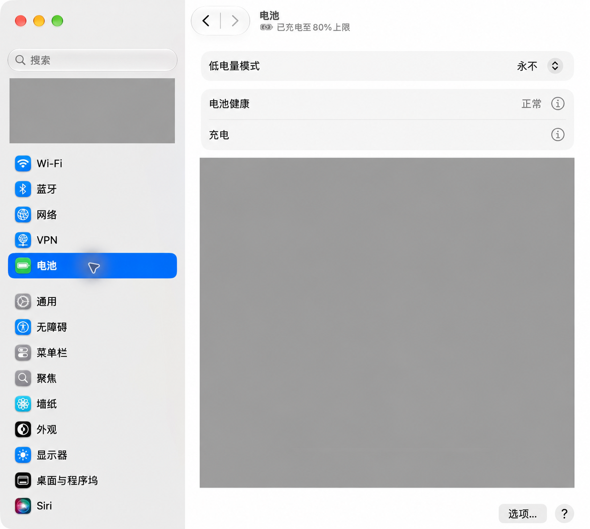
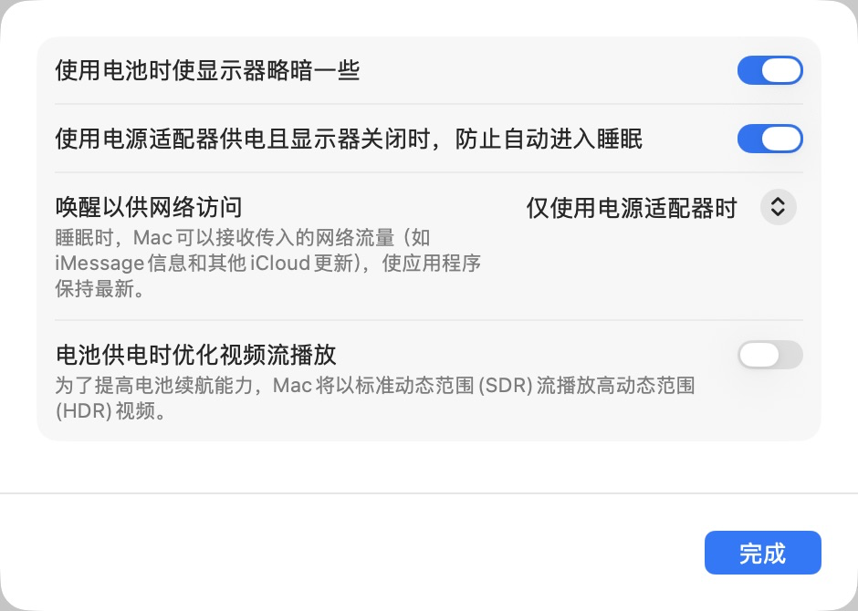
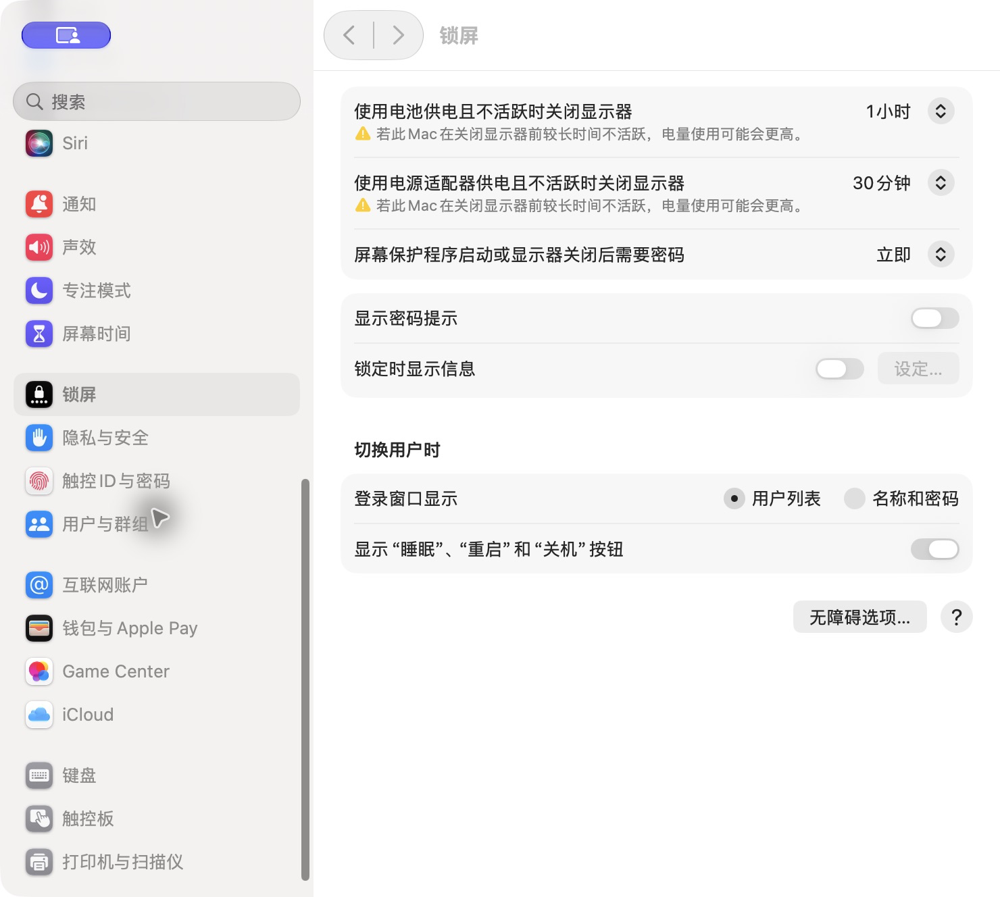

# MacBook 远程开发机：供电、熄屏与锁屏

本篇是 [MacBook 远程开发机系列](./macbook-remote-development-setup.md)的第一篇。目标是让屏幕在闲置时关闭，同时保持机器运行并保留密码锁屏。

## 前提与执行位置

- 全部设置在**服务端 MacBook**执行，截图来自 macOS 27；其他版本按相同选项含义定位。
- 接上电源，保持开盖，放在通风的桌面或支架上。
- 本篇采用接电闲置 30 分钟熄屏；读者可以选择其他时长，验收时对应调整等待时间。
- 已完成的设置只需读取和核对，无需来回切换。

## 核心原理：熄屏、锁屏与睡眠分别处理

- **熄屏**关闭显示器。设置正确时，后台任务可以继续运行。
- **锁屏**要求认证后才能使用桌面，不等于系统睡眠。
- **睡眠**会影响计算和网络连接。远程开发机应在接电时防止因闲置自动睡眠。

“唤醒以供网络访问”可以作为辅助设置，但不能代替持续运行的配置。合盖、手动选择睡眠、耗尽电量和系统重启，也不能用“防止自动睡眠”这一选项保证在线。

## 操作步骤：开盖接电，按时熄屏

### 1. 开启接电时防止自动睡眠

打开 **系统设置 → 电池**，点右下角的 **选项**。



开启 **使用电源适配器供电且显示器关闭时，防止自动进入睡眠**，然后点 **完成**。如果有“唤醒以供网络访问”，可选择“仅使用电源适配器时”。这些设置对应 [Apple 的睡眠与唤醒说明](https://support.apple.com/zh-cn/guide/mac-help/mchle41a6ccd/27/mac/27)。



### 2. 设置闲置 30 分钟熄屏并锁屏

打开 **系统设置 → 锁屏**，将 **使用电源适配器供电且不活跃时关闭显示器**改为 **30 分钟**，将 **屏幕保护程序启动或显示器关闭后需要密码**设为 **立即**。如 macOS 要求验证，应由用户在本机认证弹窗完成。



这两个计时的起点不同：显示器计时从最后一次本机活动开始，密码延迟从熄屏或屏保启动开始。本例是“闲置约 30 分钟熄屏，并立即要求密码”，不是熄屏后再等 30 分钟。如果屏保更早启动或手动锁屏，认证状态可能更早出现。图中的电池熄屏计时为 1 小时，本篇不要求沿用该值。

保持密码锁屏。手机应用会话加载异常应独立排查，不能用取消密码要求代替定位；相关案例见 [Codex 手机旧会话恢复排障](../ai-engineering/codex-mobile-session-reconnect-troubleshooting.md)。

### 3. 读取系统配置，确认保存结果

在这台 MacBook 的终端运行只读命令：

```sh
pmset -g custom
```

查看 `AC Power` 分组，关键值应为：

```text
sleep          0
displaysleep   30
```

其中 `sleep = 0` 表示禁用闲置系统睡眠计时，`displaysleep = 30` 表示显示器闲置 30 分钟后关闭。以上是两个字段的摘要，不是完整输出。可通过本机 `man pmset` 核对含义。

2026-10-10 本次实机读取确认接电分组为这两个值；锁屏界面显示接电 30 分钟熄屏、密码要求为立即。`pmset` 只核对电源字段，不能用它证明密码要求、手机会话恢复或整条远程链路正常。此前已开启的防止自动睡眠继续有效。

## 验收：配置保存与实际运行分别确认

1. 重新打开电池选项和锁屏页面，确认开关、熄屏时长与密码要求保存正确。
2. 用 `pmset -g batt` 确认当前接电，用 `pmset -g custom` 核对接电字段。
3. 完成 [网络与 SSH 篇](./macbook-remote-development-network-and-ssh.md)后，保持开盖接电，超过设定的闲置时间不触碰 Mac。
4. 从客户端**新建** SSH 连接并执行 `date`。成功才说明熄屏之后仍可以重新进入；已有连接一直未断开不能代替这项测试。

## 失败时优先检查

| 现象 | 检查位置 |
| --- | --- |
| 到时间仍未熄屏 | 是否有本机键盘、触控板活动；核对接电熄屏时长 |
| 熄屏后不能连接 | 当前供电、是否合盖、系统睡眠、Tailscale 与 SSH 状态 |
| SSH 正常但手机应用无法加载任务 | 转到对应应用的排障篇，单独验证新旧会话 |

不要通过手动睡眠或合盖来模拟熄屏验收，它们会改变测试条件。断电、耗尽电量与重启的恢复能力见 [验收与恢复篇](./macbook-remote-development-recovery-and-checks.md)。

## 公开参考

- [Apple：设定 Mac 的睡眠和唤醒设置](https://support.apple.com/zh-cn/guide/mac-help/mchle41a6ccd/27/mac/27)

## 继续阅读

[返回系列总览](./macbook-remote-development-setup.md) · 第一篇 · [下一篇：网络与 SSH](./macbook-remote-development-network-and-ssh.md)
