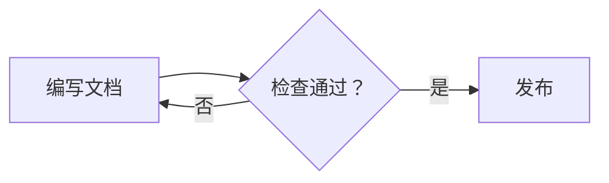
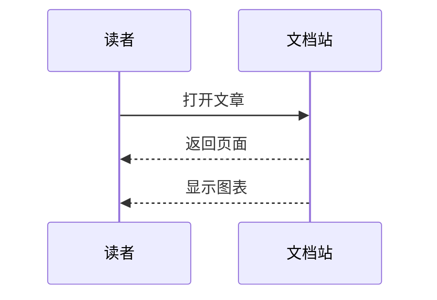
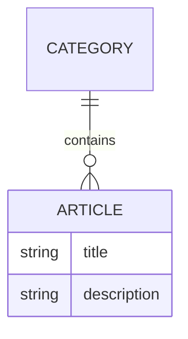

# 在文档中使用 Mermaid 图表

## 要解决的问题

流程、交互顺序和数据关系用纯文字表达时，容易遗漏连接与先后关系。Mermaid 允许在 Markdown 中用文本描述图表，图表源码与正文一起维护和审查。

## 核心原理

本站会把标记为 `mermaid` 的代码块转换为图表组件，在浏览器中生成 SVG。无需截图或上传图片，也无需在每篇文章中导入组件。

图表随站点的深浅色主题重新渲染，页面之间跳转时也会自动显示。Mermaid 按需加载；首次加载完成前，静态页面保留图表源码。

## 最小示例

### 流程图

在 Markdown 中写入以下代码块：

````markdown

````

实际效果：


`LR` 表示从左到右，改为 `TD` 则从上到下排列。

### 时序图

````markdown

````


### 实体关系图

````markdown

````


## 适用边界

- 适合流程、时序、实体关系、状态机等可以用文本表达的图表。
- 图表在浏览器中渲染，需要启用 JavaScript；无脚本环境保留源码。
- 使用 Mermaid 默认的严格安全模式，节点中的 HTML 标签和点击交互受限制。
- 大图应优先拆分，避免节点过多、标签过长而影响阅读。
- 生产构建验证 Markdown 与组件能否编译，不能代替浏览器中的 Mermaid 语法验证。

## 常见错误

- 代码块没有标记为 `mermaid`，因此显示为普通代码。
- 混淆 Mermaid 图表类型的语法；流程图、时序图和关系图有不同规则。
- 标签包含特殊字符却未使用双引号；例如应写成 `A["执行 foo()"]`。
- 手动固定节点颜色，导致切换主题后对比不足；优先使用默认配色。

图表无法渲染时，页面会提示检查语法并保留原始源码，其他图表仍可继续显示。可先在 Mermaid 官方编辑器中检查最小示例，再放回文档。

## 公开参考

- [Mermaid 使用与渲染 API](https://mermaid.js.org/config/usage.html)
- [Mermaid 流程图语法](https://mermaid.js.org/syntax/flowchart.html)
- [Mermaid 官方在线编辑器](https://mermaid.live/)
- [VitePress：在 Markdown 中使用 Vue](https://vitepress.dev/guide/using-vue)
