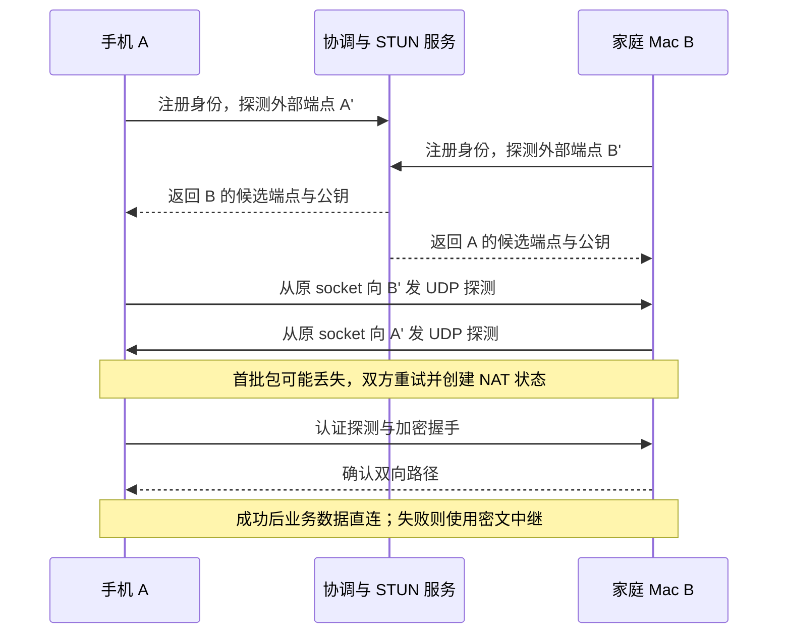
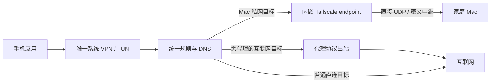
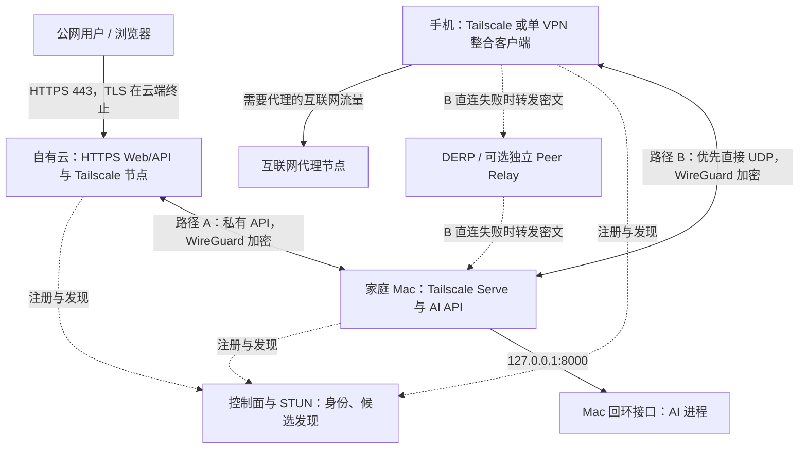
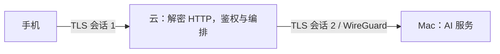

# 无公网 IP 的远程组网：原理、移动端整合与云端混合架构

家庭 MacBook 没有可供入站访问的公网 IPv4，手机也经常位于移动运营商的 NAT 后。与此同时，一台带公网地址的云服务器需要对外提供 HTTPS Web/API，并调用 Mac 上的 AI 服务。手机则希望优先直连 Mac，避免文件、远程桌面和模型结果全部经过带宽有限的云服务器，还要尽可能保留 Clash 的代理与分流能力。

推荐采用三节点 Tailscale 私有网络，将**公网业务入口、设备间数据路径、互联网代理出口**分别设计：云端终止公网 HTTPS，只获得调用 Mac 指定 API 的权限；手机通过自己的私有网络连接访问 Mac；NAT 穿透失败时使用明确的中继兜底。移动端先用官方 Tailscale 建立基线，再评估一个 VPN 内集成代理和 Tailscale 的客户端。

本文基于上述约束做技术研究与部署设计，公开资料核验日期为 **2026-10-14**。配置均为脱敏示例；部署步骤和验收标准不表示这套完整架构已经在实际设备上部署或通过测试。已有的 Mac 配置实践可配合 [Tailscale 与 SSH](./macbook-remote-development-network-and-ssh.md)、[macOS 上 Tailscale 与 Clash TUN 共存](./macos-tailscale-clash-tun-coexistence.md)阅读。

## 1. 先把三个不同问题分开

| 问题 | 需要的能力 | 不能由什么替代 |
| --- | --- | --- |
| 外部请求怎样到达 Mac | 入站端口、反向连接、打洞或中继 | 加密本身不会创建可达路径 |
| 传输途中谁能读取内容 | 指定端点之间的加密与身份校验 | “服务器属于自己”不能改变解密位置 |
| 手机如何同时组网和代理 | 操作系统允许的网络接管方式、统一路由与 DNS | 给两个独立 VPN 加分流规则不会增加 VPN 槽位 |

“无公网 IP”通常指没有独占且可接收入站连接的公网 IPv4。设备仍可通过运营商共享出口发起连接并接收回包，也可能拥有全球可路由 IPv6。没有入站 IPv4 地址与完全无法双向通信是两种不同情况。

P2P 是数据路径：两个端点之间的业务包不经应用层中继。路径仍经过路由器、运营商和公网链路。它不意味着免费流量、零延迟、无需协调服务器，也不自动意味着加密。对于本架构，P2P 的实际目标是让**手机与 Mac 的大流量不占用自有云服务器的数据转发带宽**。

## 2. NAT 与 CGNAT：为何能回包，却不能随意入站

### 2.1 地址、端口与状态表

家庭网络最常见的是 NAPT：路由器同时转换地址与端口。假设 Mac 从一个 UDP socket 向外发送数据，路由器可能创建以下状态；尖括号表示抽象地址，公网地址使用文档保留范围：

```text
内部源端点：<MAC_LAN_IP>:50000
公网源端点：192.0.2.1:62000
远端目的地：198.51.100.1:3478

出站：改写源地址与源端口，记录映射与过滤状态
入站：查询状态，允许符合条件的回包，恢复内部目的地址与端口
```

公网服务器看到的是 `192.0.2.1:62000`。它向这一端点回包时，路由器能够找到 Mac。另一个主机凭空向某个公网端口发包时，若不存在合适映射，或不符合过滤条件，数据会被丢弃。UDP 虽然没有 TCP 的连接握手，NAT 仍为其维护带超时的状态。

需要分别观察两个维度：**映射行为**决定内部 socket 对不同目的地是否复用同一个外部端点；**过滤行为**决定哪些外部来源能通过已有映射。这是 [RFC 4787](https://datatracker.ietf.org/doc/html/rfc4787) 中更精确的分析方式，比仅用“锥形 NAT／对称 NAT”一个标签更适合排障。

| 行为 | 机制 | 对打洞的影响 |
| --- | --- | --- |
| Endpoint-Independent Mapping | 同一内部端点访问不同外部目的地，复用外部映射 | 发现的外部端点更容易供对端使用 |
| 依赖目的地址或地址加端口的映射 | 更换目的地后，外部端点可能变化 | STUN 观测结果未必适用于真实对端 |
| Endpoint-Independent Filtering | 已有映射接受任意外部端点来包 | 直连较容易，但仍受其他防火墙约束 |
| 依赖地址或地址加端口的过滤 | 只接收曾主动发往的外部端点的回包 | 两端需要相互发包来建立许可状态 |

这些行为可以独立组合。发现一个稳定映射不代表任意来源都能入站；过滤严格也不必然意味着映射随目的地改变。

### 2.2 CGNAT 是增加了一层运营商管理的转换

```text
Mac → 家庭路由器 NAT → 运营商 CGNAT → 互联网
手机 → 移动运营商 NAT/防火墙 → 互联网
```

CGNAT 让多个用户共享有限的公网 IPv4。`100.64.0.0/10` 是 [RFC 6598](https://www.rfc-editor.org/info/rfc6598/) 为共享地址空间保留的范围，与 RFC 1918 私有地址空间不同。路由器 WAN 地址位于此范围是 CGNAT 的线索；仅凭一个地址不能完整确定运营商的映射和过滤策略。

家庭路由器配置端口转发，只控制家庭这一层。若运营商层没有相应映射或授权机制，公网入站仍会被阻断。DDNS 只更新名字到地址的解析，也不会让 CGNAT 自动出现入站端口。

CGNAT 并不必然阻止 P2P：如果每一层都能创建可复用的映射，并接受对端的回包，仍可能打洞成功。反过来，只有一层 NAT 也可能因为严格过滤、随机映射、UDP 禁止或企业防火墙而失败。共享公网 IPv6 可减少 IPv4 NAT 的问题，但端点防火墙、两端 IPv6 可用性和移动网络切换仍要验证。

## 3. STUN、UDP 打洞与 P2P 的完整建立过程

### 3.1 STUN 回答“外界看见我从哪里来”

客户端向 STUN 服务发送 Binding Request。服务端返回自己观察到的源地址和端口，通常通过 `XOR-MAPPED-ADDRESS` 携带。这个地址是特定探测路径、特定时刻的观测结果。[RFC 8489](https://datatracker.ietf.org/doc/html/rfc8489)定义了 STUN 协议。

STUN 不替两端搬运业务流量，不提供设备发现目录，不管理 VPN 身份，也不保证发现的端点对所有对端有效。更换 socket、探测目的地或网络后，观测结果可能变化。特别是目的地相关映射下，向 STUN 服务发包产生的外部端点，可能不同于向真正对端发包产生的外部端点。

因此，直接把 STUN 返回的地址填进配置，通常不足以完成可靠组网。系统还需要交换候选地址、协同发起探测、确认真实双向可达，并在网络变化后更新状态。候选可以包括同一局域网地址、公网 IPv6、端口映射地址和经 STUN 发现的公网 IPv4 端点。

### 3.2 UDP 打洞利用已有的出站状态

设 A 为手机，B 为 Mac，S 为可访问的协调与发现服务。简化流程如下；真实实现会并发探测多个候选，而非严格执行单一路径：



关键动作是两端都主动向对方发包。A 的出站包创建允许 B 回包的状态，B 同理。第一批包到达时对端状态可能尚未建立，所以需要重试；映射随后还需通过流量或保活维持。这不是绕过防火墙漏洞，而是在设备允许的出站与回包规则内建立路径。[Tailscale 对 NAT 穿透的技术说明](https://tailscale.com/blog/how-nat-traversal-works)介绍了候选发现和不同网络条件下的策略。

发现服务器与实际 peer 的关系非常重要：若 A 对 S 和 B 获得不同映射，B 按 A 在 S 处的观测端点发送时，就可能落到无效端口。端口预测等启发式只能提高某些环境的成功率，不能将任意网络变成可直连网络。

### 3.3 直连为什么会退化或失败

| 条件 | 可能结果 | 工程应对 |
| --- | --- | --- |
| 两端允许 UDP 且映射较稳定 | 有机会形成直接通道 | 测量建立耗时和稳态路径 |
| 映射强烈依赖目的端点 | 候选不匹配，反复打洞失败 | 使用中继，检查可用 IPv6 或可控端口映射 |
| 网络禁止 UDP，仅开放部分 TCP | WireGuard 直接 UDP 通道不可用 | 使用能通过该网络的 DERP 通道；仍需实测可达性 |
| Wi-Fi 切蜂窝、地址变化 | 旧端点失效，重新发现与探测 | 设计请求重试和流式断点恢复 |
| NAT 状态超时、手机后台受限 | 空闲后首包延迟，可能暂时回到中继 | 记录恢复过程，控制保活与电耗 |
| 家中停电、Mac 睡眠或未恢复登录 | 服务端点离线 | 中继不能唤醒不可用的服务，需独立解决在线性 |

“双方都处于 CGNAT”不是失败判据，“`netcheck` 显示 UDP 可用”也不是成功证明。最终要观察**这两个具体端点、这个网络组合、业务运行期间**的实际路径。

## 4. WireGuard、Tailscale、DERP 与控制平面的分工

### 4.1 WireGuard 负责认证与封装 IP 包

WireGuard 将内层 IP 包认证加密后封装在外层 UDP 中。对应用而言，HTTP、SSH 和其他协议都可以走虚拟网络；对公网链路而言，看到的是两端网络地址、UDP 包长度与时序，以及密文。[WireGuard 的概念说明](https://www.wireguard.com/)描述了封装和 Cryptokey Routing。

公钥与 `AllowedIPs` 的关联同时承担两项工作：发送时按内层目的地址选 peer；接收时检查解密后的源地址是否属于该 peer 被允许的范围。操作系统是否把包送入 WireGuard 接口，还取决于系统路由；`AllowedIPs` 不能代替所有系统路由和应用授权。

握手使用 Noise 模式建立会话密钥；Curve25519 用于密钥协商，ChaCha20-Poly1305 提供认证加密，并包含密钥轮换、前向保密与抗重放机制。私钥留在端点，公钥用于身份关联。加密算法、握手与计数器细节见 [WireGuard Protocol & Cryptography](https://www.wireguard.com/protocol/)。这里的“端到端”指 WireGuard peer 之间；如果 peer 是网关，保护边界就到网关为止。

WireGuard 本身不提供账户系统、候选地址目录、完整的双 NAT 穿透协调或 DERP 兜底。固定公网服务器与家庭 Mac 之间可以直接配置 WireGuard，由 Mac 主动发起握手；`PersistentKeepalive` 可维持 NAT 状态，官方给出的常用值为 25 秒，但不应对所有 peer 无条件启用。[WireGuard Quick Start](https://www.wireguard.com/quickstart/)解释了其用途。

这一点也解释了为什么代理客户端的普通 WireGuard 出站不等于 Tailscale：将出站 endpoint 指向云服务器，形成的是手机到云服务器的隧道；再由云端转发到 Mac，业务仍占云端带宽。没有额外协调与端点更新机制，不能期待它自动变为手机到 Mac 的 P2P。

### 4.2 Tailscale 在 WireGuard 之上补齐组网能力

| 层次 | 主要职责 | 业务数据是否必须经过它 |
| --- | --- | --- |
| 身份与控制平面 | 登录、节点注册、公钥与端点分发、策略管理 | 不必；它不是默认的数据中心跳点 |
| 发现与穿透机制 | 探测可达路径、交换候选、处理端点变化 | 探测与协调会用到，直连业务不必经过 |
| WireGuard 数据平面 | peer 之间的身份认证和数据加密 | 业务包由实际 peer 处理 |
| DERP 或 Peer Relay | 直连不可用时转发 peer 之间的密文 | 采用中继时会经过 |

三台设备加入同一个 Tailnet，只是让它们获得私有网络身份和策略。不会因此自动形成“手机 → 云服务器 → Mac”的星形转发，也不会自动将云服务器设为 exit node、subnet router、Peer Relay 或 DERP。

控制面不读取正常数据平面的业务内容，但它仍是身份、策略和可用性的信任依赖。其掌握的节点身份、地址和策略等元数据，也不等于完全匿名。自主托管控制面和保护业务载荷是两个独立目标。

### 4.3 DERP 是密文中继，Peer Relay 是另一条中继路径

DERP（Designated Encrypted Relay for Packets）让客户端经可达的服务端连接交换数据。常见部署使用 TCP 443 上的 TLS 连接，在无法直接 UDP 通信的网络中提供回退；其服务也支持用于发现的 STUN。中继转发的是 peer 之间的 WireGuard 密文，外层连接即使在 DERP 终止，也不会把内层业务解密成 HTTP。[DERP 官方说明](https://tailscale.com/docs/reference/derp-servers)列出了角色与网络条件。

Peer Relay 则允许显式配置某个 Tailnet 节点提供中继。它仍是额外一跳，仍消耗中继节点带宽；选择更合适的节点可能改善吞吐和延迟。[Tailscale Peer Relays](https://tailscale.com/docs/features/peer-relay)描述了这条回退路径。

当前 Tailscale 文档列出 `direct`、DERP `relay`、`peer-relay` 三种连接状态，并说明系统通过中继建立初始连通后，会尝试升级为直连或可用的 Peer Relay，也会重新检查路径。因此应区分刚建连与稳态，而不是把一次首包走 DERP 当作长期失败。[连接类型与检测方法](https://tailscale.com/docs/reference/connection-types)。

DERP 并非 TURN 协议的另一个名字，也不是 HTTPS 反向代理。其运营者可以观察连接、流量规模与时间等元数据，并能中断转发；在端点密钥未泄露、身份校验正确的前提下，不能仅靠转发身份解密内层业务。

对于带宽有限的自有云服务器，第一阶段保留它的普通节点角色，不启用中继或全局出口。需要兜底时，可先评估官方中继；若以后自建，应明确带宽预算与访问控制。自建 DERP 改变兜底路径，不会强制所有 NAT 打洞成功。

## 5. Tailscale 与蒲公英：如何比较方案

二者都能提供设备或站点之间的远程网络连接，但选型应比较实际产品能力与信任边界，而不是只比较“是否支持 P2P”。蒲公英官方资料区分 P2P 与服务器转发，也提供硬件组网和传输方式设置；具体套餐、客户端、硬件型号与加密设置需分别确认。[组网常见问题](https://service.oray.com/question/15476.html)、[管理 APP 与传输设置](https://service.oray.com/question/34353)。

| 比较维度 | Tailscale | 蒲公英 |
| --- | --- | --- |
| 适合本场景的接入方式 | 在云、Mac、手机部署节点，配合访问策略 | 软件成员或组网硬件，按具体产品接入 |
| 底层可研究性 | WireGuard、客户端与穿透机制有公开技术资料 | 公开资料以产品功能和部署指导为主，不据此推断完整协议 |
| 不可安装客户端的设备 | 可通过 subnet router 接入，需要处理路由与授权 | 硬件组网是可评估路线，需检查具体型号能力 |
| P2P 与回退 | 有明确连接状态与诊断方法 | 应检查客户端或管理平台显示的实际传输模式 |
| 移动端代理冲突 | 官方常规客户端占 VPN，需整合或改变代理接入方式 | 常规移动组网接入同样要检查系统 VPN 限制 |
| 自主控制与集成 | 可研究 tsnet、第三方控制面和自建中继 | 应以厂商提供的接口、权限与协议文档为准 |

本架构优先选择 Tailscale，理由是三台设备都能运行客户端，并且需要明确的 P2P 状态、端点加密解释和移动端整合路径。对于摄像头、打印机、旧设备及大量局域网互联，硬件网关方案可能更贴合运维条件，但不自动保证广播、多播、二层邻接或所有旧协议均透明可用。

不能因为蒲公英使用“加密隧道”这个表述，就断言中继绝对无法解密，也不能无依据断言其必然读取明文。需要确认加密是否启用、端点位置、密钥由谁持有及具体产品的安全说明。这里不推断未公开的协议细节，也不使用未经核验的 P2P 成功率、套餐价格或速度承诺。

Headscale 是自主托管 Tailscale 控制面的路线。它不是更强的打洞算法、数据中继或手机双 VPN 解决办法。只有当控制面自主性本身成为需求时，再核验兼容版本、移动端登录、策略支持、升级成本与中继配置。

## 6. Android 与 iOS：为什么 Clash 和 Tailscale 会冲突

### 6.1 冲突发生在系统网络接管层

Android 上，典型 Clash/Mihomo 客户端和 Tailscale 都通过 `VpnService` 接收系统 IP 包。Android 明确规定同一用户或配置文件只有一个活动 VPN 服务；启动另一服务会替换原来的接管者。工作配置文件是独立范围，不能借此自动让一个应用同时获得两条 VPN 路径。[Android VPN 开发文档](https://developer.android.com/develop/connectivity/vpn)。

iOS 上，常见代理客户端与 Tailscale 使用 Network Extension 的 packet tunnel。对于普通用户的这两类客户端，不能把两个独立 packet tunnel 同时接管同一批流量作为可依赖的方案。企业受管的 per-app VPN 和其他网络扩展有自己的限制，不是普通用户的通用绕行方式。[Tailscale 与其他 VPN 共存说明](https://tailscale.com/docs/reference/faq/other-vpns)、[Apple Packet Tunnel Provider](https://developer.apple.com/documentation/networkextension/packet-tunnel-provider)。

手机上的“Clash”应理解为一类规则代理需求；iOS 使用的具体代理 App、内核和扩展能力可能不同。先核对实际客户端，而不能照搬 Android 客户端名称和选项。

**分流规则只在一个已工作的网络栈里选择路径。** 在两个官方移动 VPN 互相替换的情况下，加一条 `100.64.0.0/10,DIRECT` 不会恢复已经停止的 Tailscale 栈。`DIRECT` 只是交给普通系统出站；没有 Tailscale 路径时，它也不知道如何到达 Mac 的 Tailnet 地址。

macOS 的接口与扩展组合更灵活，常见问题是地址、DNS、TUN 路由和出口选择冲突。已有 [Mac 共存实践](./macos-tailscale-clash-tun-coexistence.md)通过让出组网地址范围和调整 DNS 恢复使用，但这不是手机突破 VPN 槽位限制的证据。

### 6.2 可选整合路线及代价

| 路线 | 手机到 Mac 能否保持 P2P | 代理功能保留程度 | 主要代价 |
| --- | --- | --- | --- |
| Tailscale 占 VPN，应用显式使用 HTTP/SOCKS 代理 | 由 Tailscale 决定，可直连 | 保留支持显式代理的应用，通常不覆盖全部 App | Wi-Fi 代理、蜂窝和应用支持不一致；后台代理进程也受限制 |
| Tailscale 占 VPN，使用 exit node | 手机到 Mac 可仍有自己的直接路径 | 可改变互联网出口；不自动获得 Clash 的域名规则与订阅能力 | 互联网流量消耗 exit node 带宽；服务器端还要设计代理策略 |
| 单个客户端集成代理与 Tailscale endpoint | 有机会保留原生发现、打洞和中继 | 可保留多种代理协议与分流能力 | 不一定保留 Clash App、配置格式和每一项功能，需迁移与实测 |
| Clash 占 VPN，转到本机 userspace Tailscale SOCKS | 原理上可保持 | 可保留 Clash 内核与规则 | 需要手机可运行的集成、socket 绕行、进程生命周期及 DNS 设计 |
| Clash 的普通 WireGuard 出站经云端转发 | 默认经云端，达不到直接目标 | 较容易保留代理客户端 | 业务占用云带宽，云是 WireGuard 终点时能解密内层包 |
| 在家庭网关或路由器部署代理 | 手机仍可用 Tailscale | 特定网络或经指定出口时可保留代理效果 | 蜂窝、外出和所有 App 的行为要另外设计 |

短期建议以官方 Tailscale 测试 P2P；需要同时使用代理时，先评估目标应用是否支持显式代理。若需求是**所有 App 的透明代理与私有组网长期同时运行**，优先验证单客户端整合路线。exit node 是备选，它需要流量离开设备经指定出口，不能与“所有互联网流量也都不经过任何中继节点”混为一谈。

### 6.3 已存在的单 VPN 路线：sing-box Tailscale endpoint

sing-box 自 1.12.0 起提供 `tailscale` endpoint，官方配置包含状态目录、控制面地址、路由接受与出口节点等字段。它使代理核心与 Tailscale 节点能够在同一套程序内集成，而非必须自行从零开发。[Tailscale endpoint 文档](https://sing-box.sagernet.org/configuration/endpoint/tailscale/)。

其 Android 与 Apple 平台客户端有独立发布与能力说明。核心支持不意味着任意商店版本、任意外壳客户端都包含同样功能；应记录安装版本、内置核心版本、认证入口和后台表现，再验收。[Android 客户端](https://sing-box.sagernet.org/clients/android/)、[Apple 平台客户端](https://sing-box.sagernet.org/clients/apple/)。



下面是**并入现有 sing-box 配置的片段**，不是完整可启动配置。保留现有 TUN inbound、互联网代理 outbound 和 DNS 配置，并把私网规则置于兜底规则之前。三个 Tailnet 地址均为合成示例，必须换成实际分配地址；第一轮只路由所需节点，避免将整个共享地址空间误当成当前 Tailnet。

```json
{
  "endpoints": [
    {
      "type": "tailscale",
      "tag": "ts-private",
      "hostname": "mobile-private",
      "accept_routes": false
    }
  ],
  "route": {
    "rules": [
      {
        "ip_cidr": ["100.101.102.10/32", "100.101.102.20/32"],
        "action": "route",
        "outbound": "ts-private"
      }
    ]
  }
}
```

默认交互式登录可避免把节点注册密钥放进订阅。必须持久保存 endpoint 状态，以免重启后反复注册新节点。移动端使用一个系统 VPN，内部按目的地决定进入 Tailscale endpoint、互联网代理或普通直连。Clash YAML、provider、策略组、DNS 和控制 API 需要逐项迁移；功能相似不代表配置兼容。

首先用 Mac 的 Tailnet IP 验证，再加入私有域名和 IPv6。若配置使用 fake-IP，域名查询和随后连接必须能够正确关联；MagicDNS 所属域应进入兼容的 Tailnet 解析路径，或在原型阶段使用明确的地址映射。私有域名不得依赖公共 DNS 恰好能解析，也不应进入错误的互联网代理节点。相关配置以所用版本的 DNS 文档为准，不从新版本页面复制旧版本不支持的字段。

### 6.4 保留 Clash 客户端：userspace SOCKS 与 tsnet

Tailscale 的 userspace networking 不创建系统 TUN，通过 SOCKS5/HTTP 代理提供 Tailnet 访问；`tsnet` 则允许应用内嵌节点。它们改变的是向应用暴露网络的方式，仍可使用 Tailscale 的发现和传输机制。[Userspace networking](https://tailscale.com/docs/concepts/userspace-networking)、[tsnet](https://tailscale.com/docs/features/tsnet)。

在支持该运行方式的服务器环境，可以先验证这种组合的原理：

```sh
tailscaled --tun=userspace-networking \
  --socks5-server=127.0.0.1:1055
```

另一个终端使用对应实例的控制 socket 完成 `tailscale up`；若共存多个实例，需要独立 socket 与状态目录，避免操作错误的 daemon。代理核心再将 Mac 目的地址交给本机 SOCKS 入口：

```yaml
proxies:
  - name: Tailnet
    type: socks5
    server: 127.0.0.1
    port: 1055

rules:
  - IP-CIDR,100.101.102.10/32,Tailnet,no-resolve
```

这两段示例只说明**路由组合机制**，不是在 Android 或 iOS 安装官方 Tailscale 后即可使用的步骤。官方移动客户端没有因此自动产生上述 SOCKS 服务。手机侧仍需支持的集成程序或自定义客户端，不能把服务器 daemon 命令直接当成移动平台功能。

Android 自定义整合要让 Tailscale 的外层 UDP、STUN、DERP 与控制连接通过 `VpnService.protect()` 等正确机制绕过自己的 TUN，防止再次被送入代理入口形成循环。iOS 则需在合适的 Network Extension 生命周期中运行网络组件，处理扩展内存、恢复和系统授权；不能依赖普通后台 App 常驻一个随时可用的 daemon。

把 userspace SOCKS 放在云服务器上，仅解决手机单 VPN 接入形式：连接仍先到云端，失去了手机本机参与 P2P 的目标。对于本需求，保留 Clash 原客户端的自定义整合应作为后续研究；已有单客户端 endpoint 路线更值得先验证。

## 7. 推荐混合架构：两条业务路径、一个私有网络

### 7.1 网络拓扑



图中的控制面、发现与中继是逻辑角色，真实服务可能组合部署。路径 A 也会独立选择直连或中继；云端具有可入站的公网 UDP 往往有利于其与 Mac 建立直连，但仍受安全组和家庭网络影响。路径 B 的 `direct` 必须单独测量，不能由路径 A 成功推断。

自有云默认不承担路径 B 的中继，也不作为手机全局出口。若日后明确将它配置成 Peer Relay、DERP 或手机代理节点，相应流量当然会经过它，须重新计入预算。

### 7.2 路径 A：公网服务调用家庭 AI

```text
公网用户 --HTTPS--> 云端 Web/API
云端应用 --HTTPS over Tailscale--> Mac Serve
Mac Serve --回环 HTTP--> AI 进程
```

云端负责用户鉴权、请求校验、配额、任务编排和对公网的响应；Mac 提供受限 AI 能力。可以让 Mac AI 只监听 `127.0.0.1:8000`，由 Serve 在 Tailnet 内提供 HTTPS 入口，避免把未经保护的模型服务器直接暴露到全部网卡。

对简单系统，云到 Mac 的 HTTP 也已受到 WireGuard 链路加密保护，前提是这段请求确实进入隧道。但本文推荐内部 HTTPS：除传输保护外，它能表达服务身份与证书校验边界，便于以后移动服务或跨越网关。它不让云端调用者失去解密能力。

公网请求触发的 AI 输入和输出会通过云应用，因此必然占用云端相应带宽。手机 P2P 仅节省它**主动走路径 B**的流量。大文件可由手机直接提交到 Mac，云端只管理任务标识与状态；若公网用户无法接入私网，他们仍需经过公网入口或另一种公开上传方案。

### 7.3 路径 B：手机直接使用 Mac

手机访问 Mac 的 Tailnet 地址或私有 HTTPS 域名，而不是云端公开域名。这样数据路径才能交由手机与 Mac 的组网连接选择。若 UI 继续调用云端 API，即使底层同时存在 P2P 通道，该业务也不会自动改走直连。

移动 App 或前端可设计显式的两种服务地址，显示当前连接目标；支持自动选择时，要校验身份和健康状态，处理重复提交与状态一致性。公网 HTTPS 页面访问私网 API 还涉及 CORS、浏览器私网/本地网络权限和安全上下文；先用原生 App、独立私网页面或命令行验证，不能把路由可达等同于浏览器一定允许调用。

“不消耗自有云服务器中继带宽”有两种验收口径：稳态 `direct` 时不搬运这条业务；若使用第三方 DERP，仍有中继流量，但不由自有云承担。若要求任何大流量绝不经过中继，则要在应用层设定连接条件或暂停传输，并接受可用性下降；路径还可能在传输中改变，单次预检不足以保证整个会话。

## 8. 加密边界：云服务器何时能看到明文

### 8.1 安全边界由端点与密钥决定

HTTPS 保护 HTTP 客户端到 TLS 服务端之间的传输，服务端认证来自证书与信任链；HTTP 内容在 TLS 终止点可读。SSH 保护 SSH 客户端到 SSH 服务端的通道，主机密钥校验确认连接对象。WireGuard 保护配置的 peer 之间的内层 IP 包。[TLS 1.3](https://datatracker.ietf.org/doc/html/rfc8446)、[SSH Transport](https://datatracker.ietf.org/doc/html/rfc4253)。

要逐层问三个问题：谁终止这一层协议，谁持有会话密钥，解密后的数据交给谁。协议名称本身不能回答“整条业务链路中谁可信”。

| 实际结构 | 云能否读取业务明文 | 理由 |
| --- | --- | --- |
| 手机 HTTPS 到云，云 HTTP/HTTPS 到 Mac | 能 | 手机 TLS 在云终止，云重新发起上游请求 |
| 云应用经 WireGuard/Tailscale 调用 Mac | 能读取自身请求与响应 | 云是该连接的端点；WireGuard 保护途中而不隐藏给调用者 |
| 手机 WG 到云，云路由后 WG 到 Mac，内层 HTTP | 能 | 云解密第一段内层包，再加密第二段；仅转发不代表不可读 |
| 上一结构内再叠加手机到 Mac 的 HTTPS | 正确验证证书时不能读取 HTTP 内容 | 云虽可解密 WG 层，内层仍是手机到 Mac 的 TLS 密文 |
| 手机到 Mac 的 Tailscale，经云端 DERP/Peer Relay | 正常中继角色不能 | 内层 WG peer 是手机和 Mac，云只搬运密文 |
| 手机到 Mac 的 HTTPS，经云端四层 TCP 透传 | 正确验证 Mac 身份时不能读取 HTTP 内容 | TLS 在 Mac 终止，云仅转发 TCP 字节 |
| 手机 SSH 到云，再从云 SSH 到 Mac | 能读取在云上终止的会话 | 云是第一段 SSH 服务器，跳转产生另一会话 |
| 手机 `ProxyJump` 经云，对 Mac 建立 SSH 会话 | 不能读取内层 SSH 会话内容 | 目标 SSH 握手与主机认证仍发生在手机和 Mac 之间 |

所有“不能读取”均针对所述协议和角色，假定端点、密钥、信任链和身份校验未被攻破；云仍可记录流量元数据、丢包、拒绝服务。云拥有目标 TLS 私钥、能替换客户端信任证书或控制终端时，结论需要重新评估。

### 8.2 两段 HTTPS 与 TLS 透传的能力差异



这个结构适合公网业务网关，但云能够看到提示词、输入和模型结果。给云到 Mac 再加 HTTPS，只增加这一段的传输与服务身份保护，不会把两段会话合并成端到端加密。

若改为四层透传，手机和 Mac 建立同一个 TLS 会话；云不能再对密文内部的 URL、JSON、HTTP token 做常规鉴权或内容路由，但可按连接、目的端口等元数据实施部分控制。Mac 后方的隧道可达性仍要另行解决。云替浏览器提供的网页脚本也是信任边界：若云能修改前端，便可能使终端在加密前泄露内容。

### 8.3 SSH 反向隧道与堡垒机并不等价

Mac 可以主动连接云的 SSH 服务，建立回环地址上的远程转发：

```sh
ssh -N -o ExitOnForwardFailure=yes \
  -R 127.0.0.1:18000:127.0.0.1:8000 \
  '<USER_ID>@cloud.example.com'
```

云的回环端口只作为本机入口，可避免直接向公网开放 AI 服务。但若其转发的是 HTTP，SSH 保护的是 Mac 到云这段运输，云仍可读取远程端口流量。若其中承载的是由手机发起、在 Mac 终止并正确校验证书的 TLS，会话内容仍受到那一层 TLS 保护。

同理，`ProxyJump` 可以让手机经云访问 Mac 的 SSH，且保留手机到 Mac 的内层 SSH 认证和加密。它避免云读取内层会话内容，却仍让数据经过云，不能满足节省中继带宽的目标。普通“先登录堡垒机，再手动 SSH 目标”还多了在堡垒机终止的会话和潜在凭据暴露面。

### 8.4 云端编排与对云保密的关系

云应用要检查 AI 输入、执行业务逻辑并消费结果，就必须拥有对应内容。若希望对云隐藏载荷，可设计手机先加密、Mac 解密的应用层端到端协议，云仅处理不透明任务和公开元数据；密钥分发、重放防护、授权、恢复和可信客户端分发都需要重新设计。

本推荐架构接受云能读取**路径 A**的输入输出，并通过权限与运行隔离限制其能力；**路径 B**由手机与 Mac 直接建立加密通道。即使云属于本人，也仍可能因公网漏洞、恶意依赖、日志或主机管理员权限而泄露在云端终止的明文。

## 9. 部署步骤：先得到基线，再增加复杂度

### 9.1 准备节点与可恢复性

1. 云和 Mac 使用当前受支持的 Tailscale 发行版，手机先安装官方客户端。记录系统版本、客户端版本与安装形态，三端加入同一个 Tailnet。
2. 在云端安全组与主机防火墙开放公开 Web 所需的端口；允许组网所需出站和回包。若允许云端直接接收 Tailscale UDP，按发行版确认监听端口，常见为 UDP 41641，不要把它与 WireGuard 常见的 51820 混为固定要求。
3. Mac 关闭闲置睡眠，验证接电、锁屏、重启后网络与服务恢复。登录项不等于系统未登录时已启动；FileVault 解锁与开机恢复另行验收。[供电与锁屏](./macbook-remote-development-power-and-sleep.md)、[恢复与维护](./macbook-remote-development-recovery-and-checks.md)。
4. 查询 `tailscale status` 和 `tailscale ip -4`。下文合成地址约定：Mac 为 `100.101.102.10`、云为 `.20`、手机为 `.30`；实际配置必须替换，不要手工强迫 Tailscale 分配这些地址。
5. 第一阶段不启用 exit node、子网路由、自建 DERP 或 Peer Relay。Mac 若已有 Clash TUN，按共存文章核对组网路由和 DNS；不要无依据关闭全 Tailnet 的 DNS 功能。

### 9.2 给云端最少的 Mac 访问权限

默认 Tailnet 策略可能允许所有节点互通。加入私网不等于权限已经最小化。以下是独立 Tailnet 的 ACL 示例，需合并既有必要规则，并移除覆盖它的宽泛放行；可使用当前推荐的 grants 表达同样约束。[Tailscale ACL 说明](https://tailscale.com/docs/features/access-control/acls)。

```json
{
  "tagOwners": {
    "tag:cloud-api": ["autogroup:admin"],
    "tag:mac-ai": ["autogroup:admin"]
  },
  "acls": [
    {
      "action": "accept",
      "src": ["tag:cloud-api"],
      "dst": ["tag:mac-ai:443"]
    },
    {
      "action": "accept",
      "src": ["owner@example.com"],
      "dst": ["tag:mac-ai:443", "tag:mac-ai:22"]
    }
  ]
}
```

把 `owner@example.com` 换成实际身份后只保存在私有配置；文档不记录真实账户。管理员批准云与 Mac 的标签，手机保持所有者用户身份。第二条允许该用户拥有的节点，不是只允许一台手机；若需要精确到设备，应加入相应设备范围或姿态约束。

这些规则允许云调用 Mac 的 HTTPS API，却不允许云新建 SSH 连接，也不授予家庭 LAN 的任意访问。返回流量依赖连接状态，不需为响应添加反向全开放规则。授权只约束 Tailnet 路径，不会替代 Mac 对其他网卡的主机防火墙，也不会限制同一云主机上所有进程的权限。

公网应用与组网身份之间还应有运行隔离：以独立用户、容器或专用网关进程运行服务，限制可访问端口及凭据。云主机获得 `tag:cloud-api` 后，能使用它的主机进程可能都具有相应网络能力，不能仅凭标签断言“只有 Web 进程能访问 Mac”。

### 9.3 在 Mac 提供私有 HTTPS API

AI 进程监听 `127.0.0.1:8000`，实现 `/healthz` 与有限的业务 API。通过 Tailscale Serve 暴露给 Tailnet：

```sh
tailscale serve --bg --https=443 http://127.0.0.1:8000
tailscale serve status
```

按提示启用 Tailnet HTTPS，并记录输出的完整 DNS 名称；CLI 选项以本机 `tailscale serve --help` 为准。Serve 将 HTTPS 终止于 Mac，再转发到本机 AI 进程。不要把 Serve 与对公网分享服务的 Funnel 混淆。[Serve 命令参考](https://tailscale.com/docs/reference/tailscale-cli/serve)。

这里选用 Serve 暴露普通节点上的私有端口，不涉及另一套跨节点服务发现产品。Tailnet 策略中的端口要与 Serve 实际监听端口一致。若改用直接监听 Tailnet IP 的 HTTP，则应同时修改访问策略、云端上游地址和主机防火墙，不能只改变 URL。

Mac API 保留应用鉴权、输入大小上限、任务并发和审计；这些控制不是链路加密可以替代的。对外展示的健康信息不包含提示词或个人数据。使用 Tailnet HTTPS 证书还要考虑公开证书透明度日志可能暴露设备 FQDN，设备命名避免包含敏感业务信息。

### 9.4 云端公开 HTTPS 与 AI 调用

公网 DNS 将 `api.example.com` 指向云。云端 Caddy 可以终止 TLS，并转发给本机业务后端：

```text
api.example.com {
    reverse_proxy 127.0.0.1:8080
}
```

公网域名与 ACME 验证端口按实际部署准备；此配置只展示入口。后端使用 Mac Serve 输出的 FQDN 访问 `https://<MAC_FQDN>/...`，校验证书，不使用 `-k` 或跳过校验。云端健康验证可先执行：

```sh
MAC_FQDN='<MAC_FQDN>'
curl --fail --connect-timeout 5 --max-time 15 \
  "https://${MAC_FQDN}/healthz"
```

URL 要使用证书中的域名，不能把 HTTPS 地址直接换成 Tailnet IP 后通过关闭校验来消除报错。容器中的后端还要核对 DNS 是否能解析该 FQDN、网络是否能路由到 Tailnet，宿主机 `curl` 成功不能证明容器成功。

业务后端负责登录、鉴权、限流和任务队列。对流式推理测试首 token 延迟、代理刷新行为、超时与客户端取消传播；对长期任务设置有限并发、幂等键、断线恢复和 Mac 离线时的明确状态。若直接反向代理 Mac API，也必须补上这些公开入口控制，不能把裸模型接口暴露给互联网。[Caddy reverse_proxy](https://caddyserver.com/docs/caddyfile/directives/reverse_proxy)。

### 9.5 验证手机 P2P，再迁移代理

1. 手机关闭另一套 VPN，启用官方 Tailscale，关闭 exit node。使用 Tailnet 地址访问 Mac 的私有 HTTPS 或 SSH。
2. 手机退出家庭 Wi-Fi，使用蜂窝网络；在 Mac 查看到该手机的实际路径和业务传输状态。家庭同一 Wi-Fi 的成功不足以证明远程穿透。
3. 若直连成功率、延迟和吞吐满足要求，再验证 sing-box 单 VPN endpoint。关闭官方 Tailscale VPN，避免两个客户端竞争；内嵌 endpoint 是一个新的 Tailnet 节点，要检查它的身份和授权。
4. 先配置必要 Mac 地址，再迁移代理节点、域名规则、DNS、IPv6 与订阅更新。逐项对照所需功能，不能将代理迁移失败误判成 P2P 失败。
5. 保存一套能恢复的配置，验证重启、锁屏、切网、后台和 endpoint 状态持久化。若整合尚不稳定，保留官方客户端基线作为诊断入口。

## 10. 验证方法：连得上只是第一项

### 10.1 将地址、路径、身份和应用分开检查

在云或 Mac 上执行：

```sh
tailscale version
tailscale netcheck
tailscale status
tailscale ping --c=10 '<PEER_NAME_OR_IP>'
```

`netcheck` 描述本机外层网络条件，`tailscale ping` 与 `status` 用于识别对端的路径。普通 ICMP ping 可能被策略或系统限制；userspace 网络也不直接提供同样的系统 ICMP 语义，因此它不能单独证明整套应用不可用。

| 观察 | 可以支持的结论 | 仍未证明什么 |
| --- | --- | --- |
| `netcheck` 显示 UDP 可用 | 这个节点能完成部分 UDP 探测 | 任意对端都可以直连 |
| 手机对应节点显示 `direct` | 观测时该 peer 使用直接路径 | 整个未来会话不再退回中继 |
| 显示 `relay` 或 `peer-relay` | 当时存在中继数据路径 | 中继是自有云；需确认中继位置 |
| `/healthz` 返回成功 | 路由、TLS 与该健康端点可用 | 大请求、流式输出、授权和并发正确 |
| 云到 Mac 通、手机到 Mac 不通 | 两条 peer 路径条件可能不同 | Mac 整体离线或必须改成云转发 |

手机单客户端没有 CLI 时，在 Mac 观察新的手机 endpoint，结合客户端日志、连接目标与业务统计确认。测试 peer 必须是手机实际使用的那个节点，不能误看其已经停用的官方客户端节点。

### 10.2 用云流量计数证明带宽目标

暂停公网 AI 请求、云端代理和其他大流量，记录云网卡接收/发送字节计数；让手机通过私网从 Mac 下载一个已知大小的测试文件，再读计数。Linux 可读取相应接口下的 `rx_bytes`、`tx_bytes`，并与云监控交叉验证。重复测试不同网络，每次记录 `direct/relay/peer-relay`。

验收预期是：文件数据由 Mac 与手机交换，云的增量不随该文件大小近似等量增长。少量管理、心跳或其他背景流量可以存在；云计数很低只能证明未明显经过云，**不能区分直接连接与第三方中继**，所以必须结合 peer 路径观测。

吞吐瓶颈在直连时大致取决于家庭上行、手机链路、两端处理能力、丢包与时延；经过中继时再增加中继带宽和路径约束。不要把云公网带宽参数当成手机 P2P 的速度上限，也不要以一张拓扑图宣称“零中继”。

### 10.3 授权与加密边界验收

| 场景 | 推荐预期 |
| --- | --- |
| 云访问 Mac 的 443 | 允许；完成服务证书与应用鉴权 |
| 云访问 Mac 的 22 或其他未授权端口 | 拒绝；在策略测试和真实连接中验证 |
| 未授权 Tailnet 身份访问 Mac | 拒绝；确认没有宽泛规则覆盖 |
| Mac AI 8000 从公网或家庭 LAN 访问 | 不可直接到达；进程只监听回环 |
| 手机正常代理互联网，同时访问 Mac | 两类业务都成功，私网目标不进入错误代理出口 |
| 云的网关记录可见业务 JSON | 路径 A 中属于预期，但日志应最小化 |
| 外层网络抓包 | 只能验证这一层观察不到业务明文，不能证明所有端点都可信 |

抓包时区分物理接口与虚拟接口：物理接口通常见加密外层，隧道解封装后的接口可能见 HTTP；若内层仍有 TLS 则继续是密文。为了验收加密而记录敏感提示词或导出真实密钥会引入新的泄露风险，应使用合成测试数据。

### 10.4 移动端与失败恢复矩阵

| 测试条件 | 记录指标 |
| --- | --- |
| 家庭 Wi-Fi、外部 Wi-Fi、蜂窝分别访问 | 首次连接时间、稳态路径、吞吐、首 token 延迟 |
| IPv4-only、双栈、UDP 受限网络 | 可达性、回退中继、策略和超时表现 |
| Wi-Fi 与蜂窝互切 | 中断时间、重新直连时间、重复任务风险 |
| 锁屏、长时间后台、省电模式 | endpoint 存活与恢复、额外电耗 |
| Clash/整合客户端重启与规则更新 | 状态目录保留、认证恢复、路由是否被覆盖 |
| Mac 睡眠、重启、未解锁、AI 进程退出 | 云端离线状态、限时失败、队列积压、恢复流程 |
| 持续流式结果与较大文件 | 路径是否变化、取消传播、超时与断点恢复 |

允许中继兜底能提高可用性；强制拒绝中继能限制带宽但会让部分网络直接不可用。这是产品与可靠性策略，需要依据实际测量决定。

## 11. 待解决问题与演进条件

| 未决问题 | 需要的证据或决定 | 后续行动 |
| --- | --- | --- |
| 家庭宽带与常用蜂窝的直连成功率 | 多次跨网测试与运行期间的路径记录 | 决定是否改善 IPv6、可控端口映射或中继位置 |
| 手机必须保留哪些 Clash 能力 | 代理协议、规则、订阅、DNS、UDP、App 分流的功能清单 | 逐项验收 sing-box 迁移，而非仅比较界面 |
| Android/iOS 所用客户端是否包含可用 endpoint | 实际安装版本、认证、持久化和后台测试 | 固定可复现版本与恢复配置 |
| 是否必须对云隐藏 AI 内容 | 明确云能否编排、读取和审计输入输出 | 若要求保密，设计独立的端到端应用协议与可信客户端 |
| 浏览器能否直接访问私网 API | CORS、私网权限、TLS 与 DNS 的实测 | 选择独立私网页面、原生客户端或受控调用入口 |
| Mac 能否承担长期生产后端 | 供电、家庭上行、热管理、服务恢复与并发测试 | 需要更高 SLA 时迁往常在线主机或增加备用 worker |
| 是否需要自建控制面或中继 | 官方服务可达性、管理自主性、维护能力 | 分别评估 Headscale 与 DERP/Peer Relay，不捆绑引入 |
| 是否严格禁止中继大流量 | 带宽预算与离线可用性的取舍 | 在应用中监测路径并设定降级或暂停策略 |

演进顺序是：先完成云与 Mac 的受限私网调用，再取得手机跨网 P2P 基线，再整合移动代理，最后根据数据决定自主控制面或中继。对于只有三台可安装客户端的设备，这条路线可以把复杂度集中在真实限制上，而不是预先建设一套完整网络运营平台。

## 12. 公开参考与延伸阅读

协议原理：

- [RFC 4787：UDP NAT 的映射与过滤行为](https://datatracker.ietf.org/doc/html/rfc4787)
- [RFC 6598：CGN 共享地址空间](https://www.rfc-editor.org/info/rfc6598/)
- [RFC 8489：STUN](https://datatracker.ietf.org/doc/html/rfc8489)
- [WireGuard：概念与 Cryptokey Routing](https://www.wireguard.com/)
- [WireGuard：协议与密码学](https://www.wireguard.com/protocol/)
- [WireGuard：保活与配置](https://www.wireguard.com/quickstart/)
- [RFC 8446：TLS 1.3](https://datatracker.ietf.org/doc/html/rfc8446)
- [RFC 4253：SSH Transport](https://datatracker.ietf.org/doc/html/rfc4253)

组网与移动端：

- [Tailscale：NAT 穿透机制](https://tailscale.com/blog/how-nat-traversal-works)
- [Tailscale：连接类型与诊断](https://tailscale.com/docs/reference/connection-types)
- [Tailscale：DERP](https://tailscale.com/docs/reference/derp-servers)
- [Tailscale：Peer Relay](https://tailscale.com/docs/features/peer-relay)
- [Tailscale：与其他 VPN 共存的限制](https://tailscale.com/docs/reference/faq/other-vpns)
- [Tailscale：Userspace networking](https://tailscale.com/docs/concepts/userspace-networking)
- [Tailscale：tsnet 应用内嵌节点](https://tailscale.com/docs/features/tsnet)
- [Android：VpnService 与 socket protect](https://developer.android.com/develop/connectivity/vpn)
- [Apple：Packet Tunnel Provider](https://developer.apple.com/documentation/networkextension/packet-tunnel-provider)
- [sing-box：Tailscale endpoint](https://sing-box.sagernet.org/configuration/endpoint/tailscale/)
- [蒲公英：组网常见问题](https://service.oray.com/question/15476.html)

部署配套：

- [Tailscale：ACL 与默认策略](https://tailscale.com/docs/features/access-control/acls)
- [Tailscale：Serve CLI](https://tailscale.com/docs/reference/tailscale-cli/serve)
- [Caddy：reverse_proxy](https://caddyserver.com/docs/caddyfile/directives/reverse_proxy)
- [Journal：MacBook 远程开发机系列](./macbook-remote-development-setup.md)
- [Journal：macOS 的 Tailscale 与 Clash TUN 共存](./macos-tailscale-clash-tun-coexistence.md)
