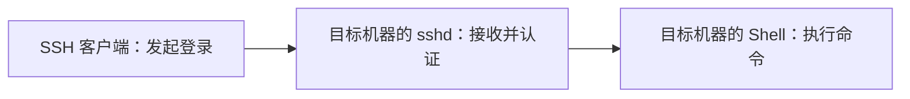
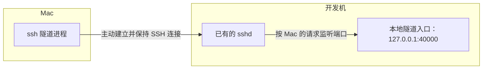
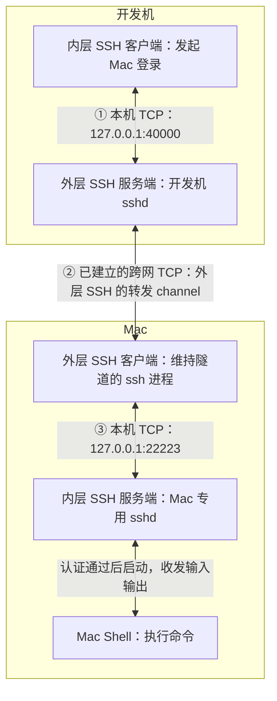
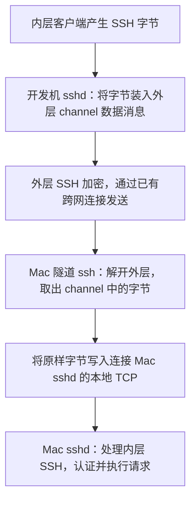

# 反向隧道里的两层 SSH：连接方向、转发通道与命令执行

Mac 可以主动 SSH 到开发机，开发机却不能直接连接 Mac。于是先由 Mac 建立反向隧道，再让开发机通过隧道登录 Mac。

这个过程容易产生三个疑问：中继是不是就在开发机上？既然已经有一条 SSH 连接，为什么还要再来一次 SSH？内层 SSH 的数据到底怎样通过外层连接传输？

下面始终使用同一个通用例子：开发机运行 Linux，Mac 提供命令执行环境。所有别名、账户和端口都是教学示例，不对应实际部署，也不表示命令已在读者环境运行。

## 先分清 ssh、sshd 和 Shell

`ssh` 是客户端，负责发起 SSH 登录；`sshd` 是服务端，负责接收连接、验证身份，并按请求启动 Shell 或执行命令；Shell 才是解释和运行命令的程序。

例如，在 Mac 上执行 `ssh dev-server 'pwd'`，`pwd` 运行在开发机上。客户端在哪里输入命令，与命令最终在哪里执行，是两件事。

普通登录的关系是：



SSH 服务端不一定只能由系统的“远程登录”开关管理，也可以由应用单独启动和管理。这里假设 Mac 已有一个可用的专用 sshd，监听 `127.0.0.1:22223`；反向隧道本身不会替你启动它。

## 中继就在开发机上，Mac 先向它搭通道

“中继”描述的是转发职责，不一定代表第三台机器。在这个例子里，开发机既运行用户的 SSH 客户端，也由自己已有的 sshd 承担转发职责。

先在 Mac 上建立外层连接：

```bash
ssh -NT \
  -o ExitOnForwardFailure=yes \
  -R 127.0.0.1:40000:127.0.0.1:22223 \
  dev-server
```

运行前，`dev-server` 应是 Mac 已正确配置、完成主机身份校验且能认证的开发机入口；开发机 SSH 策略也需允许该反向转发。`-N` 表示不执行开发机命令，`-T` 表示不申请伪终端。

`-R` 的含义是：请开发机监听自己的 `127.0.0.1:40000`；有人连接时，经当前 SSH 连接把字节送回 Mac，再由 Mac 连接自己的 `127.0.0.1:22223`。两个 `127.0.0.1` 分别属于两台机器。[OpenSSH ssh 手册](https://man.openbsd.org/ssh#R)



“Mac 主动连接”只说明谁发起建连。连接建立后，数据可以双向传输，开发机能够沿已建立的连接把数据送回 Mac。“反向”描述的是入口与连接建立方向的关系，不表示数据只能向一个方向流动。

## 为什么还要再建立一次 SSH 登录？

现在，在开发机执行：

```bash
ssh -p 40000 mac-user@127.0.0.1
```

入口地址虽然是开发机本机，真正接收这次 SSH 登录的却是 Mac 的 sshd。需要校验的是 Mac 的主机身份，认证的也是 Mac 账户；能够登录开发机，不会自动获得登录 Mac 的权限。

两次 SSH 各有自己的角色：

| 层次 | 客户端 | 服务端 | 负责什么 |
| --- | --- | --- | --- |
| 外层 SSH | Mac 的隧道 ssh 进程 | 开发机已有的 sshd | 提供反向转发通道 |
| 内层 SSH | 开发机发起登录的 ssh 客户端 | Mac 的专用 sshd | 校验 Mac 身份、认证账户、请求命令或交互终端 |

为什么不能让开发机直接利用外层连接，要求 Mac 执行命令？

**能够双向传数据，不代表标准 SSH 的登录角色可以直接互换。** 外层连接中，Mac 是客户端，开发机是被登录的一方；开发机的标准 sshd 不会因此获得反过来在 Mac 客户端启动 Shell 的功能。

当然可以在 Mac 上编写一个程序，接收开发机发送的命令、执行，再返回结果。这样可以复用已有通道，但需要设计执行请求与权限、输入输出、退出码、终端交互等行为。这里采用内层 SSH，是为了直接复用成熟的 SSH 登录与命令执行能力。SSH 会话和执行请求的定义见 [RFC 4254 第 6 节](https://www.rfc-editor.org/rfc/rfc4254.html#section-6)。

## 内层字节怎样通过外层连接？

**内层 SSH 产生的字节，被装进外层 SSH 的转发通道，也就是 channel，作为普通数据运输。** Mac 的隧道进程取出这些字节后，原样写给 Mac 的 sshd。

双向箭头表示请求和结果都能经过同一路径：



从内层看，开发机的 ssh 客户端正在和 Mac 的 sshd 对话；从外层看，开发机 sshd 和 Mac 隧道 ssh 只是在转运一条字节流。

具体衔接发生在开发机 sshd 接受 `40000` 入口的新连接时：

1. 开发机 sshd 在已有的外层 SSH 连接中打开一个 `forwarded-tcpip` channel。
2. Mac 的隧道 ssh 接收这个请求，连接 Mac 本机的 `22223`，将这条本地连接与该 channel 关联。
3. 开发机 sshd 从入口连接读到内层字节，把它们放入 channel 数据消息，经外层 SSH 发送。
4. Mac 的隧道 ssh 解开外层报文，按通道标识取出字节，写入通向 Mac sshd 的本地连接。反向数据按相反路径返回。

每条新进入的 TCP 连接对应独立的转发 channel；不需要为每次登录重新建立外层 SSH。channel 建立和数据消息分别由 [RFC 4254 第 7.2 节](https://www.rfc-editor.org/rfc/rfc4254.html#section-7.2)和[第 5.2 节](https://www.rfc-editor.org/rfc/rfc4254.html#section-5.2)定义。

## 把一段内层数据“装进去，再取出来”

下面单独画从开发机到 Mac 的数据方向；输出返回时路径相反：



内层握手并启用加密后，跨网传输的内容可以概念性地看成：

```text
外层 SSH 加密 {
    转发通道编号
    一段内层 SSH 加密后的字节
}
```

这只是封装关系示意，不是完整报文格式，也不表示一个内层报文恰好对应一个外层报文。外层搬运的是字节流，读取、分块和发送不必保留内层报文边界；内层最初的版本交换等握手字节也不能一概称为密文。SSH 传输报文和加密规则见 [RFC 4253 第 6 节](https://www.rfc-editor.org/rfc/rfc4253.html#section-6)。

因此，Mac 的隧道 ssh 进程只解开外层；内层仍由 Mac 的 sshd 处理。中间转发进程无需解析内层登录请求，也无需理解其中传输的是 Shell 输入、文件内容还是其他 SSH 会话数据。

## 两层 SSH 会话，对应三段 TCP

“两次 SSH”容易让人以为开发机又额外建立了一条直达 Mac 的跨网连接。这个例子实际有三段 TCP：

| 段 | TCP 连接两端 | 作用 |
| --- | --- | --- |
| ① 开发机本机 | 开发机内层 ssh → 开发机 sshd 的 `40000` 入口 | 接收内层 SSH 字节 |
| ② 跨网络 | Mac 隧道 ssh → 开发机已有 sshd 的 SSH 端口 | 运送外层 SSH 及其中的转发 channel |
| ③ Mac 本机 | Mac 隧道 ssh → Mac 专用 sshd 的 `22223` 端口 | 交付内层 SSH 字节 |

内层 SSH 协议使用的是这三段拼接起来的连续字节流。它没有把开发机本地 TCP 的完整网络包原封不动套进另一层 TCP，而是通过外层 SSH channel 转运应用字节。

这也解释了为什么开发机连接自己的回环地址，最后却能操作 Mac：开发机本地端口只是入口，身份认证和命令执行发生在字节流另一端的 Mac sshd 上。
