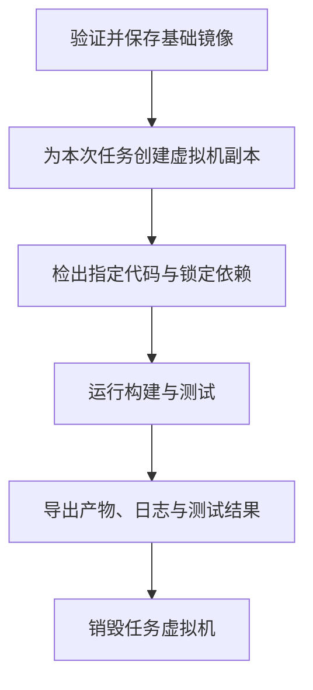

# Tart：为什么在虚拟机中构建与测试 macOS 应用

## 要解决的问题

在团队共用的 Mac 上运行构建，容易把项目依赖与机器长期积累的状态混在一起：升级 Xcode 后老项目失败，上一次任务留下的缓存影响下一次任务，不同项目修改同一份全局配置，或者 CI 失败但本地无法复现。

虚拟机让团队可以保存一套验证过的系统和工具链，并为每个构建任务创建独立副本。它的主要收益是环境一致、任务隔离和容易重建；是否值得采用，取决于这些问题的维护成本。

## 核心原理

### Tart 管理什么

Tart 是在 Apple Silicon Mac 上创建、运行和管理 macOS、Linux 虚拟机的工具集，底层使用 Apple 的 `Virtualization.Framework`。可以把它理解为：用命令行和镜像管理方式，管理一台完整的虚拟电脑。[仓库 README](https://github.com/openai/tart#readme)

各层的分工如下：

| 层次 | 职责 |
| --- | --- |
| 物理 Mac | 提供 CPU、内存、磁盘和网络资源 |
| Tart | 创建、克隆、启动和管理虚拟机及其镜像 |
| 虚拟机中的 macOS 与工具链 | 提供项目需要的系统、Xcode、SDK 和其他依赖 |
| CI 配置与执行工具 | 传入代码、执行构建与测试、收集日志和产物、安排清理 |

编译仍由 Xcode、Swift 等工具完成。Tart 自身只负责虚拟机管理；官方介绍了通过 Cirrus CLI 执行脚本、处理缓存和取出构建产物的集成方式。[CI 集成文档](https://tart.run/integrations/cirrus-cli/)

### 为什么每次从固定镜像开始

假设某个项目已在一组 macOS、Xcode、SDK 和依赖版本上验证通过，可以将这组环境做成基础镜像，由 CI 按以下流程使用：



这是一种需要在 CI 中实现的工作方式，单独运行 `tart run` 不会自动完成代码检出、产物导出或任务结束后的清理。

它把几类变化分开处理：

- **项目变化**：由代码提交、构建脚本和依赖锁文件记录。
- **工具链变化**：通过新镜像版本升级，验证后再切换，保留旧版本用于回退。
- **任务产生的状态**：留在本次任务的副本中，结束后清理。
- **需要复用的缓存**：显式恢复与保存，并按工具链和依赖版本划分缓存键。

镜像固定的是环境的一部分。要复现某次失败，还需要记录镜像标识、代码提交、构建命令、依赖版本和必要的运行条件。

## 典型使用场景

| 场景 | 原来的困难 | 虚拟机的价值 |
| --- | --- | --- |
| iOS、macOS 应用自动构建 | 不同机器的系统和 Xcode 环境不一致 | 使用经过验证的镜像执行构建 |
| 同时维护新旧分支 | 新项目升级工具链后影响老项目 | 不同分支选择不同镜像 |
| 多个项目共用构建资源 | 全局配置、文件和进程相互干扰 | 任务拥有独立的系统环境 |
| macOS 版本兼容性测试 | 重装系统和切换测试环境成本高 | 在受支持的系统镜像中重复运行测试 |
| 复现 CI 故障 | 开发者难以还原 CI 机器的状态 | 复用同一镜像、代码和任务配置进行排查 |
| 安装与卸载测试 | 软件安装后改变系统状态，影响后续测试 | 每轮从预设状态开始，结束后清理副本 |

例如，项目的稳定分支继续使用已验证的工具链镜像，开发分支在另一个镜像中试验升级。升级失败时可以继续使用旧镜像构建，避免把共用构建机改成一个难以恢复的中间状态。

## 最小示例

以下示例用于体验启动 macOS 虚拟机，不包含应用构建。先按[仓库安装说明](https://github.com/openai/tart#usage)安装 Tart，再运行：

```bash
tart clone ghcr.io/cirruslabs/macos-tahoe-base:latest demo-macos
tart run demo-macos
```

按核对时的仓库说明，宿主机要求 Apple Silicon 和 macOS 13 或更新版本；首次下载此示例镜像约需 25 GB。具体客户机、镜像和工具链的兼容条件仍需按所选版本确认。

官方也提供预装 Xcode 的镜像。需要运行编译任务时，应选择或制作包含对应工具链的镜像，再由 CI 工具执行项目的构建脚本。[镜像与创建方法](https://tart.run/quick-start/)

示例中的 `latest` 适合快速体验。长期维护的 CI 应使用团队维护的不可变镜像版本或已确认支持的摘要引用，并记录实际使用的镜像身份，避免同一条配置在不同日期拉到不同环境。

Tart 支持把虚拟机镜像存入 OCI 兼容仓库，便于多台构建机使用同一份环境。OCI 是存储与分发接口的兼容性：普通 Docker 容器镜像不能直接作为 Tart 虚拟机启动。[OCI 镜像说明](https://tart.run/quick-start/#working-with-a-remote-oci-container-registry)

## 适用边界

### 什么时候值得引入

当构建频繁、工具链版本较多、环境污染反复出现，或者必须在多个 macOS 环境中验证时，可以先选一个项目接入，对比环境故障次数、排障耗时和构建资源成本。

如果只是个人偶尔打包、环境稳定，直接在本机运行通常更省维护工作。项目能够在现有的 Linux 容器 CI 中完成构建时，也应先评估现有方案是否已经满足需求。

### 虚拟机仍有成本和边界

- **资源成本**：需要额外的磁盘、内存、镜像下载和启动时间；同一台 Mac 上的虚拟机仍共享物理资源。
- **维护成本**：基础镜像需要更新、验证、版本化和清理，不能只制作一次就长期忽略。
- **复现边界**：固定镜像不保证产物逐字节相同；时间戳、网络资源、外部服务和非确定性测试仍可能影响结果。
- **隔离边界**：显式挂载的宿主目录、共享缓存和外部服务仍可能被多个任务共同访问，需要按任务设计访问范围。
- **测试边界**：虚拟机中的构建成功不能代替目标设备上的运行验证；涉及真实硬件的功能仍需要对应设备测试。

## 常见错误

| 误区 | 应采用的做法 |
| --- | --- |
| 把一台长期使用的虚拟机当作干净环境 | 为每次任务从受控基础镜像创建副本 |
| 镜像固定就等于构建可复现 | 同时固定代码、依赖和构建配置，记录外部条件 |
| 为了复用缓存，把整个旧环境传给下个任务 | 单独管理缓存及其键，保留环境边界 |
| 开了多个虚拟机就一定更快 | 按 CPU、内存和磁盘压力设置并发，测量整体吞吐量 |
| Tart 会自动完成整个 CI 流程 | 明确脚本执行、超时、失败日志导出和清理责任 |

## 验证依据

本文于 2026-10-14 核对了 Tart 仓库 README、Quick Start 和 CI 集成文档。工具职责、镜像示例和集成能力有公开文档依据；一次性环境流程、场景选择和成本分析属于基于这些能力的工程建议。

本次整理未安装 Tart、下载镜像或执行实际应用构建，不构成对某个项目、macOS 与 Xcode 组合的实测认证。接入时应先验证镜像启动、真实构建、产物导出和失败清理，再扩大使用范围。

## 公开参考

- [Tart 仓库与 README](https://github.com/openai/tart)：定位、安装和运行条件。
- [Tart Quick Start](https://tart.run/quick-start/)：系统镜像、镜像创建、目录挂载和 OCI 仓库。
- [Tart 与 Cirrus CLI 集成](https://tart.run/integrations/cirrus-cli/)：在虚拟机中执行 CI 脚本与提取产物。

相关知识：[macOS 上使用 Docker CLI 连接 Podman](/knowledge/engineering/docker-cli-with-podman-on-macos)。
